<div align="center">


<br/>

[](https://flutter.dev)
[](https://dart.dev)
[](https://riverpod.dev)
[](https://pub.dev/packages/go_router)
[](https://pub.dev/packages/dio)

[](docs/SETUP.md#android)
[](docs/SETUP.md#ios)
[](docs/SETUP.md#web)
[](docs/SETUP.md#linux-windows-and-macos)
[](docs/SETUP.md#linux-windows-and-macos)
[](docs/SETUP.md#linux-windows-and-macos)
[](docs/MAPS_AND_PLACES.md)
[](LICENSE)

[](https://github.com/peacemakerbill/premisave_flutter_frontend/commits/main)
[](https://github.com/peacemakerbill/premisave_flutter_frontend/stargazers)
[](https://github.com/peacemakerbill/premisave_flutter_frontend/issues)
[](https://github.com/peacemakerbill/premisave_auth_service)

**[Quick start](#quick-start)** &nbsp;|&nbsp; **[How it works](#how-it-works)** &nbsp;|&nbsp; **[Roles](#roles-and-access)** &nbsp;|&nbsp; **[Platforms](#platforms)** &nbsp;|&nbsp; **[Themes](#themes-and-textures)** &nbsp;|&nbsp; **[Docs](#documentation)**

</div>


## What is this?

Premisave is a real estate platform. This repository is its **Flutter app**: one codebase for Android, iOS, the web, Linux, Windows and macOS. It talks to the Spring Boot [auth-service](https://github.com/peacemakerbill/premisave_auth_service), which owns accounts, sessions, profiles, security and the home owner application.

Everyone signs in to the **same app**. What they see after that depends on their role. A client explores properties and applies to become a home owner. Staff review those applications. An administrator approves them and manages users. Adding a new kind of account does not mean touching screens: you describe it once in [`lib/src/roles/role_registry.dart`](lib/src/roles/role_registry.dart) and the navigation, the route guards and the home screen follow.

| | |
| --- | --- |
| **One app, six roles** | Client, home owner, operations, finance, support and administrator, each with its own tabs and dashboard. |
| **Sign in your way** | Email and password, Google, Facebook and GitHub, with email verification, password reset and admin invitations. |
| **Security you can see** | Sessions, devices, sign-in history and security events are all on screen, and a person can end any session. |
| **Real maps** | Google Maps on Android, iOS and the web, OpenStreetMap everywhere else, one `PlaceMapView` in front of both. |
| **14 themes, 11 textures** | Light, dark, high contrast, nine fonts and three corner styles, saved per device. |
| **Small to learn** | 146 Dart files, about 22 thousand lines, one rule per layer. See [how it works](#how-it-works). |


## Contents

- [Quick start](#quick-start)
- [What is connected](#what-is-connected)
- [How it works](#how-it-works)
- [Roles and access](#roles-and-access)
- [Platforms](#platforms)
- [Themes and textures](#themes-and-textures)
- [Project layout](#project-layout)
- [Configuration](#configuration)
- [Everyday commands](#everyday-commands)
- [Documentation](#documentation)
- [Known gaps](#known-gaps)
- [Built with](#built-with)
- [Code at a glance](#code-at-a-glance)
- [Contributing](#contributing)
- [License and author](#license-and-author)


## Quick start

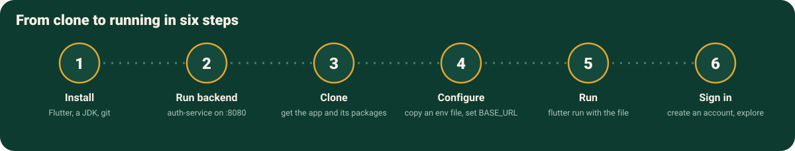

You need the backend running first, because the app has nothing to sign in to without it. The full walk through, with every prerequisite and the things that usually go wrong, is in **[docs/SETUP.md](docs/SETUP.md)**. The short version:

**1. Install the tools.** [Flutter](https://docs.flutter.dev/get-started/install) (Dart 3.3 or newer comes with it), plus Java 21, Docker and git for the backend. Run `flutter doctor` and fix whatever it complains about for the platform you want.

**2. Run the backend.**

```bash
git clone https://github.com/peacemakerbill/premisave_auth_service.git
cd premisave_auth_service
docker run -d --name auth-mongo -p 27017:27017 mongo:8
docker run -d --name auth-redis -p 6379:6379 redis:7
cp .env.example .env        # then fill it in, see the backend README
sh ./mvnw spring-boot:run
```

When it is up, `http://localhost:8080/health` answers with a status banner.

**3. Get the app.**

```bash
git clone https://github.com/peacemakerbill/premisave_flutter_frontend.git
cd premisave_flutter_frontend
flutter pub get
```

**4. Pick an environment file.** The ones in [`config/env/`](config/env) hold only public values. Copy one to a name ending in `.local.json` (git ignores those) and change what you need, most often `BASE_URL`:

```bash
cp config/env/development.json config/env/dev.local.json
```

**5. Run it.**

```bash
flutter run -d chrome --web-port=3000 --dart-define-from-file=config/env/dev.local.json
```

Keep the web port at 3000: the GitHub sign in callback in development points at `http://localhost:3000/auth.html`.

**Or let the launcher ask.** It lists every device Flutter can see (a browser, this computer's desktop, a plugged in phone, an emulator or simulator), then asks which settings file and which mode, and runs the app.

```bash
./run.sh           # Linux, macOS, WSL and Git Bash
run.bat            # Windows, double click it or type it in a terminal
```

Skip the questions with flags, for example `./run.sh --platform linux --env development.local --mode debug`. `./run.sh --help` lists them all.

**6. Sign in.** Create an account on the welcome screen, open the activation link from the email, and you are in. To see the staff and administrator screens, sign in with one of the administrator accounts the backend creates from its `.env`.

> **Real phone or emulator?** The Android emulator reaches your computer at `10.0.2.2`, which the app already uses by default. A real phone needs your computer's address on the network, for example `--dart-define=BASE_URL=http://192.168.1.20:8080`.


## What is connected

Everything marked **live** talks to the real auth-service. The rest shows sample data until its own service exists, and the Home screen says so.

| Area | State | What you get |
| --- | :---: | --- |
| Sign in and sign up | live | Email and password, email verification, resend activation, forgot and reset password, admin invitation links |
| Social sign in | live | Google, Facebook and GitHub, with the right flow for each platform ([details](docs/SIGN_IN_PROVIDERS.md)) |
| Sessions | live | Rotating refresh tokens, remembered device, expiry handling that returns you to sign in |
| Profile | live | Details, photo upload, change password, location with a map picker, who viewed you |
| Security centre | live | Active sessions, known devices, sign-in history, security events, "this was not me" reports |
| People | live | Directory, follow, like, reviews and public profiles |
| Home owner application | live | Guided form, document upload, status, withdraw and reapply |
| Staff review | live | Queue and decisions on submitted applications |
| Administration | live | User list and details, role changes, platform wide audit trail, final approval of applications |
| Places | live | Address search and "what is here", through the auth-service when it has a Google key, free Photon search otherwise |
| Messages | live | Chats, groups, replies, reactions, files, typing and online status, statuses, group invite links and QR codes, voice and video calls (one to one, group, call links, screen share), through the messenger service. See [docs/MESSENGER.md](docs/MESSENGER.md) |
| Bookings, payments, transactions, wishlists | sample | Screens are built, the services behind them are not |


## How it works


The app has four layers and each one has a single job.

| Layer | Folder | Job | May call |
| --- | --- | --- | --- |
| Screens | `lib/src/features` | Draw things and react to taps | State |
| State | `lib/src/state` | Hold what a screen needs, as Riverpod providers | Repositories |
| Repositories | `lib/src/data` | Turn endpoints into typed Dart objects | `ApiClient` |
| ApiClient | `lib/src/core/network` | Dio, tokens, refresh, readable errors | The network |

A screen never touches Dio. If you are adding something, follow the arrows left to right and you will end up in the right folder. The full explanation, with the reasons behind each choice and a worked example of adding a feature, is in **[docs/ARCHITECTURE.md](docs/ARCHITECTURE.md)**.

### Staying signed in


The backend rotates refresh tokens: each one works once and the answer carries the next. Two screens loading at the same moment could both try to spend the same token, so `ApiClient` lets **only one refresh run at a time** and makes the others wait for its result. That detail is the difference between an app that stays signed in and one that signs people out at random.

### Which screen opens first

The router decides, using the session and the person's role:

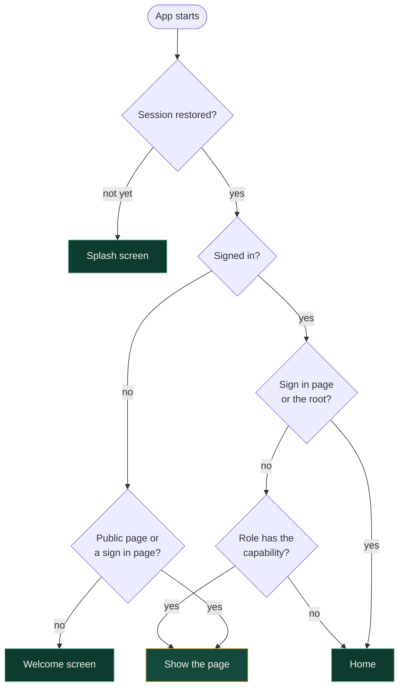


## Roles and access


Screens and routes never ask "is this an administrator?". They ask for a **capability**, such as `manageUsers`, and `role_registry.dart` says which roles have it. That is why a new role is one entry in one file, and why forgetting to describe a new role is a compile error: the `switch` over `Role` has no default.

```dart
// lib/src/router/guards.dart, the whole access table for guarded pages
const List<(String, Capability)> _guarded = <(String, Capability)>[
  ('/admin/audit', Capability.viewAuditTrail),
  ('/admin', Capability.manageUsers),
  ('/staff', Capability.reviewApplications),
  ('/explore', Capability.exploreProperties),
];
```

The grid above is generated from the real registry, so it cannot drift from the code. Adding a role is walked through in **[docs/ROLES_AND_ACCESS.md](docs/ROLES_AND_ACCESS.md)**.


## Platforms


The app builds for all six targets. A few things differ because the platforms do:

- **Maps.** Google offers a map component for Android, iOS and the web only. On Linux, Windows and macOS the app uses OpenStreetMap, and Google's place data is not mixed in there, because Google's terms keep it off other companies' maps. See **[docs/MAPS_AND_PLACES.md](docs/MAPS_AND_PLACES.md)**.
- **Sign in.** Linux and Windows cannot run Google's or Facebook's own sign in, so they open the browser, catch an authorization code on a local port and hand it to the backend. See **[docs/SIGN_IN_PROVIDERS.md](docs/SIGN_IN_PROVIDERS.md)**.
- **Linux package.** `linux/flatpak/` builds a Flatpak that carries the libraries the app needs, so people install the app and nothing else. See `linux/flatpak/README.md`.
- **Native setup.** Cells marked with a star need the platform's own app registration and native files, which this repository does not include yet. The code is in place.


## Themes and textures


Every colour on screen comes from the active `AppPalette` through `context.pal`, so a new theme is one entry in [`palette.dart`](lib/src/core/theme/palette.dart) and it appears in the picker on its own. By default the app follows the device: Premisave in light mode, Premisave Night in dark mode. Press **T** anywhere on desktop or web to step through the themes, **Shift+T** to go back.

Each theme can draw one of eleven textures behind every screen. They glide slowly, and stop when the device asks to reduce motion:

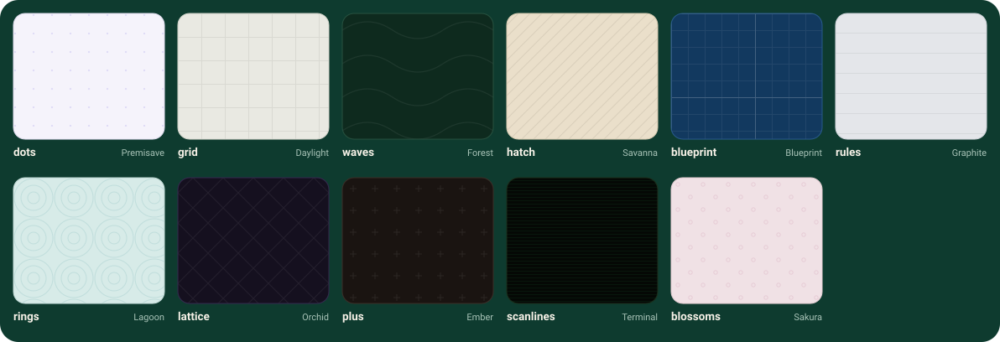

Fonts (nine choices) and corner styles (sharp, standard, soft) are separate settings, so the same palette can look quite different. All of it is explained in **[docs/THEMING.md](docs/THEMING.md)**.


## Project layout

```text
premisave_flutter_frontend/
|-- lib/
|   |-- main.dart                  starts the app, restores look and session first
|   `-- src/
|       |-- core/                  things every feature uses
|       |   |-- branding/          logo and social provider marks, drawn in code
|       |   |-- config/            AppConfig, the one place that reads --dart-define
|       |   |-- network/           ApiClient (Dio) and ApiException
|       |   |-- storage/           TokenStore on flutter_secure_storage
|       |   |-- theme/             palettes, textures, fonts, corners
|       |   |-- utils/             formatters and validators
|       |   `-- widgets/           buttons, fields, scaffolds, empty states
|       |-- data/
|       |   |-- models/            typed objects parsed from JSON
|       |   |-- repositories/      one class per backend area
|       |   `-- social_auth_service.dart
|       |-- state/                 Riverpod providers and the session controller
|       |-- router/                go_router, role guards, page transitions
|       |-- roles/                 Role, Capability and the registry
|       `-- features/              one folder per part of the product
|-- config/env/                    development, staging and production settings
|-- assets/                        brand images and the font families
|-- docs/                          the guides, and the pictures used in them
|-- tool/readme_assets.py          redraws the pictures in docs/assets
|-- android/ ios/ web/ linux/ windows/ macos/
`-- run.sh, run.bat, run.ps1       pick a platform or device, then run the app
```


## Configuration

The app reads its settings at build time with `--dart-define`, and `AppConfig` is the only file that does. You rarely pass them one by one: a JSON file per environment holds them and you hand Flutter the file.

| Key | Needed for | Default |
| --- | --- | --- |
| `BASE_URL` | Where the auth-service lives | `http://localhost:8080`, or `http://10.0.2.2:8080` on the Android emulator |
| `MESSENGER_URL` | Where the messenger service lives | `http://localhost:8081`, or `http://10.0.2.2:8081` on the Android emulator |
| `GROUP_INVITE_BASE_URL` | The address shown in group invite links and QR codes | `https://premisave.com/join` |
| `GOOGLE_SERVER_CLIENT_ID`, `GOOGLE_CLIENT_ID` | Google sign in | The project's own web client |
| `GITHUB_CLIENT_ID`, `GITHUB_REDIRECT_URI` | GitHub sign in, and the code flow on Linux and Windows | Client built in, redirect `http://localhost:3000/auth.html` in debug builds |
| `FACEBOOK_APP_ID` | Facebook sign in on web and desktop | The project's own app |
| `GOOGLE_MAPS_ANDROID_KEY`, `GOOGLE_MAPS_IOS_KEY`, `GOOGLE_MAPS_WEB_KEY` | Google Maps, one public key per platform | Empty, so OpenStreetMap is used |
| `GEOCODER_URL`, `MAP_TILE_URL` | Your own address search and tile servers | Public Photon and OpenStreetMap servers |
| `SUPPORT_EMAIL` | The address shown on help screens | A development address, change it for production |

> **A Flutter app ships inside the download, so anything in these files can be read by users.** Only public values belong here. The Google key the auth-service uses for places is a secret and lives in the backend's `.env`, never here.

Every key, the environments, the `.local.json` convention and the iOS key file are explained in **[config/env/README.md](config/env/README.md)**.


## Everyday commands

```bash
flutter pub get                                   # install packages
flutter analyze                                   # static analysis, keep it at zero issues
dart format lib                                   # format the code

# run
flutter run -d chrome --web-port=3000 --dart-define-from-file=config/env/dev.local.json
flutter run -d linux   --dart-define-from-file=config/env/dev.local.json
flutter run            --dart-define-from-file=config/env/dev.local.json     # connected phone or emulator
./run.sh                                          # asks which platform, settings file and mode
./run.sh --platform web --env staging             # web on port 3000 with config/env/staging.json

# build
flutter build web --release --dart-define-from-file=config/env/production.json
flutter build apk --release --dart-define-from-file=config/env/production.json
flutter build appbundle --release --dart-define-from-file=config/env/production.json

# redraw the pictures in docs/assets after a big change
python3 tool/readme_assets.py
```

After changing a `--dart-define` value, **stop the app and start it again**. Flutter reads them only at launch, and hot reload will not pick them up.


## Documentation

| Guide | Read it when |
| --- | --- |
| **[docs/SETUP.md](docs/SETUP.md)** | You are setting the project up on a new machine, or something does not start |
| **[docs/ARCHITECTURE.md](docs/ARCHITECTURE.md)** | You want to understand the layers, or add a feature |
| **[docs/ROLES_AND_ACCESS.md](docs/ROLES_AND_ACCESS.md)** | You are adding a role, a capability or a guarded page |
| **[docs/SIGN_IN_PROVIDERS.md](docs/SIGN_IN_PROVIDERS.md)** | You are setting up Google, Facebook or GitHub sign in |
| **[docs/MAPS_AND_PLACES.md](docs/MAPS_AND_PLACES.md)** | You are creating Google Maps keys, or maps and search misbehave |
| **[docs/THEMING.md](docs/THEMING.md)** | You are adding a theme, a texture or a font |
| **[config/env/README.md](config/env/README.md)** | You are filling in an environment file |
| **[Backend README](https://github.com/peacemakerbill/premisave_auth_service#readme)** | You need the API, the `.env` reference or the data model |


## Known gaps

Being straight about what is not finished saves everyone a debugging session.

- **Bookings, payments, transactions and wishlists** show sample data. The screens exist, the services do not.
- **Native social sign in on Android, iOS and macOS** needs each platform's own app registration (Google services files, Facebook app configuration, URL schemes). The Dart side is written, the native files are not in the repository.
- **Sign in with Apple** is not implemented yet.
- **There are no automated tests.** `flutter analyze` is the safety net today.
- **Google Maps on Android and iOS** needs a key and, for iOS, a small local file. Without them those platforms fall back to OpenStreetMap. See [docs/MAPS_AND_PLACES.md](docs/MAPS_AND_PLACES.md).
- Before a production release, set `SUPPORT_EMAIL`, add your production domain and release signing SHA-1 to the map keys, and use your own address search and tile servers if you expect real traffic.


## Built with


## Code at a glance

These two charts are counted from the real source by [`tool/readme_assets.py`](tool/readme_assets.py), blank lines and comments excluded. Run the script again to refresh them.




## Contributing

1. Make a branch from `main`.
2. Put code in the layer that owns it (see [How it works](#how-it-works)). A screen that imports Dio is in the wrong place.
3. Ask for a capability, not a role.
4. Take colours from `context.pal`, never from a literal, so every theme works.
5. Run `flutter analyze` and leave it at zero issues.
6. Do not commit anything private. Environment files are public by nature, and `.local.json` files are ignored for a reason.

Open an [issue](https://github.com/peacemakerbill/premisave_flutter_frontend/issues) first if the change is large, so we can agree on the shape of it.

## License and author

Released under the [MIT License](LICENSE).

<table>
  <tr>
    <td align="center" width="180">
      <a href="https://github.com/peacemakerbill">
        <br/>
        <sub><b>Bill Graham Peacemaker</b></sub>
      </a>
    </td>
    <td>
      <b>Backend Developer &amp; API Support Engineer at Safaricom PLC</b><br/>
      Nairobi, Kenya<br/><br/>
      Enterprise systems developer and API integration specialist, working across backend microservices (Java and Spring Boot), Flutter frontends and DevOps.<br/><br/>
      <a href="https://github.com/peacemakerbill"></a>
      <br/><br/>
      Related: <a href="https://github.com/peacemakerbill/premisave_auth_service">premisave_auth_service</a> ·
      <a href="https://github.com/peacemakerbill/premisave-wallet-service">premisave-wallet-service</a> ·
      <a href="https://github.com/peacemakerbill?tab=repositories">all repositories</a>
    </td>
  </tr>
</table>
