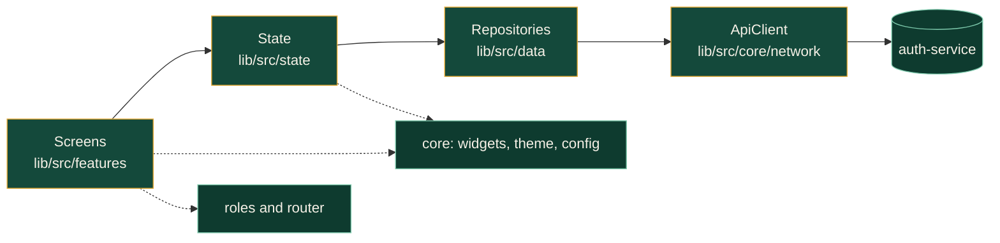
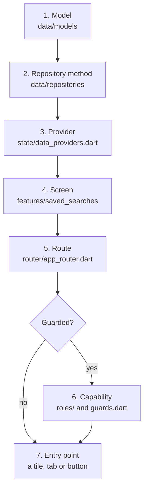

# Architecture



This guide explains how the app is put together and why, so you can find your way around in a few minutes and add a feature without breaking the rules. The size is small on purpose: 146 Dart files, about 22 thousand lines, and every file lives in the layer that owns its job.

**On this page**
[The four layers](#the-four-layers) |
[Start up](#start-up) |
[Talking to the backend](#talking-to-the-backend) |
[State](#state) |
[Navigation](#navigation) |
[The shared widget kit](#the-shared-widget-kit) |
[Errors](#errors) |
[Add a feature, step by step](#add-a-feature-step-by-step) |
[Rules of the house](#rules-of-the-house)

## The four layers



Each layer may talk to the one on its right and to nothing further. That is the whole architecture.

| Layer | What lives there | The rule |
| --- | --- | --- |
| **Screens** `features/<name>/` | Widgets, one folder per part of the product | Never imports Dio or a repository directly. Reads providers, calls provider methods |
| **State** `state/` | Riverpod providers, the session controller, the appearance controller | Holds what a screen needs. Calls repositories. Never builds widgets |
| **Repositories** `data/repositories/` | One class per backend area: `AuthRepository`, `ProfileRepository`, `SecurityRepository` and so on | Knows endpoint paths and JSON. Returns typed models. Never knows about screens |
| **ApiClient** `core/network/` | Dio, tokens, refresh, error translation | The only code that touches the network, apart from the free address search fallback |

Beside the layers sit the pieces everyone shares:

| Folder | Holds |
| --- | --- |
| `core/config` | `AppConfig`, the one place that reads `--dart-define` values |
| `core/theme` | Palettes, textures, fonts, corners, `context.pal` |
| `core/widgets` | The shared widget kit: buttons, fields, cards, empty and error states |
| `core/storage` | `TokenStore`, tokens in the platform's secure storage |
| `core/branding` | The logo and the social provider marks, drawn in code so they scale and recolour |
| `roles/` | `Role`, `Capability` and the registry that connects them |
| `router/` | go_router, the guards, the page transitions |
| `data/models/` | Plain Dart objects parsed from JSON, with forgiving readers in `json_utils.dart` |

## Start up

`main()` does four things in order, **before the first frame**, so the app never flashes the wrong theme or the wrong screen:

```dart
final container = ProviderContainer();
await container.read(appearanceProvider.notifier).load();      // saved theme, font, corners
await SocialAuthService.init();                                // Facebook on web and desktop needs its app ID early
await container.read(sessionProvider.notifier).bootstrap();    // restore the session, if any
runApp(UncontrolledProviderScope(container: container, child: const PremisaveApp()));
```

`bootstrap()` reads the saved tokens, asks the backend who the person is (`GET /profile/me`), and sets the session to signed in or signed out. If the backend cannot be reached it falls back to the cached user, so opening the app offline does not log anyone out. Until bootstrap finishes the router shows the splash screen.

## Talking to the backend

`ApiClient` wraps Dio and does four jobs for every request, so no screen or repository repeats them:

1. **Headers.** `X-Client-Platform: mobile` on everything, which tells the backend to return the remembered device token in the JSON body, which every Flutter target needs, including the web. `X-Device-Token` once known. `Authorization: Bearer ...` on protected endpoints.
2. **Refresh before expiry.** If the access token expires in under 45 seconds, it is refreshed first.
3. **Refresh after a 401.** If the server still says 401, refresh once and send the request again. A multipart upload cannot be replayed, so it is not.
4. **Readable errors.** Anything that goes wrong becomes an `ApiException` with a message a person can read.



Refresh tokens **rotate**: each one works once and the answer carries the next. If two requests noticed the expiry at the same moment and both refreshed, the second would present a token that was already spent, and the backend would end the session. So refreshes are single flight:

```dart
Future<bool> refresh() => _refreshing ??= _doRefresh().whenComplete(() => _refreshing = null);
```

The first caller starts the refresh and stores its `Future`. Everyone who arrives meanwhile gets the same `Future` back. When it completes the slot is cleared. The refresh call itself goes through a second, bare Dio with no interceptors, so it can never trigger itself.

If the backend rejects the refresh token, `ApiClient` clears the saved session and calls `onSessionExpired`, which the session controller turns into "signed out, with a notice", and the router sends the person to the sign in screen.

Some endpoints must never carry a token, because a stale one can get the request rejected. They are listed in `_publicPaths` in `api_client.dart`: sign in, sign up, social sign in, refresh, password reset and a few more. If you add a public endpoint, add it there.

## State

State is Riverpod 2 and there are only three shapes of provider.

**Repository providers** in `state/providers.dart` create each repository once and hand it the shared `ApiClient`.

```dart
final socialRepositoryProvider = Provider<SocialRepository>((ref) => SocialRepository(ref.watch(apiClientProvider)));
```

**Data providers** in `state/data_providers.dart` fetch something for a screen. They are all `autoDispose`, so leaving the screen drops the data and the next visit loads fresh:

```dart
final directoryProvider = FutureProvider.autoDispose<List<DirectoryEntry>>(
  (ref) => ref.watch(profileRepositoryProvider).directory(),
);
```

After a change, or on pull to refresh, a screen calls `ref.invalidate(directoryProvider)` and the list reloads. Providers that depend on an id use `.family`.

**Controllers** hold state that outlives screens and has actions on it:

| Controller | Holds | Notable detail |
| --- | --- | --- |
| `sessionProvider` | `booting`, `signedOut` or `signedIn`, the user and their role | The router listens to it and re-evaluates whenever the status or the role changes |
| `appearanceProvider` | Theme, font and corner style | Saved in `shared_preferences`. `auto` follows the device |

## Navigation

go_router owns every screen change. The public pages (welcome, login, sign up, verify and so on) sit at the top. Everything for a signed in person sits inside one `ShellRoute`, which draws the bottom bar on phones and a side rail on wide screens. Detail pages open on top of a tab and keep the bar.

Two functions decide who may see what:

- The router's `redirect` looks at the session. Booting goes to the splash. Signed out goes to the welcome screen unless the page is public. Signed in sends sign in pages and the root to Home.
- `canOpen(role, location)` in `router/guards.dart` checks the capability the page needs. If the role lacks it, the person goes to Home.

The decision tree is drawn in the [README](../README.md#which-screen-opens-first). The access table is **data**, not code, and is explained in [ROLES_AND_ACCESS.md](ROLES_AND_ACCESS.md).

Pages that a link from an email opens (`/verify`, `/reset-password`, `/admin-invitation`, `/security-report`) are open whether or not anyone is signed in, because the person clicking an activation link has no session yet.

## The shared widget kit

`core/widgets/widgets.dart` exports everything below, so one import is enough. Use these instead of building your own, and a new screen looks right in every theme without extra work.

| Widget | Use it for |
| --- | --- |
| `SubPage` | A screen opened from a tab: back arrow, title, actions |
| `PageTitle`, `ContentWidth`, `PageBody` | Titles and a comfortable reading width on large screens |
| `PCard`, `HeroPanel`, `SectionHeader`, `StatTile`, `StatusPill`, `InfoRow` | Surfaces and small display pieces |
| `MenuGroup`, `MenuTile` | Settings style lists |
| `AsyncBody<T>` | Turns an `AsyncValue` into a skeleton while loading, a retry on failure and your builder on success |
| `LoadingState`, `EmptyState`, `ErrorState`, `SkeletonList` | The states a list passes through |
| `PButton`, `PTextField`, `PScaffold` | Buttons, fields and the page background with the theme's texture |

Colours always come from `context.pal`, a getter on `BuildContext` that returns the active `AppPalette`. A literal colour in a widget is a bug: it looks fine in one theme and unreadable in the next. Text styles come from the theme's font choice, so changing the font changes every screen.

## Errors

Every failure reaches a screen as an `ApiException`, whatever went wrong underneath.

```dart
class ApiException implements Exception {
  final String message;                       // safe to show to a person
  final int? statusCode;
  final Map<String, String> fieldErrors;      // from validation, keyed by field
  final bool isNetwork;                       // no connection, timeout
  // isUnauthorized, isForbidden, isNotFound, isConflict, isRateLimited ...
}
```

The auth-service answers errors in three shapes (a message, a map of field errors, or a message with details) and `ApiException.from` understands all of them. A form shows `fieldError('email')` under the right field, and `AsyncBody` shows an `ErrorState` with a retry button for a failed load. A screen never parses an error body itself.

## Add a feature, step by step

Suppose the backend gains `GET /saved-searches` and you want a screen for it. This is the path, in order. The code is an illustration of the pattern, not a feature that exists today.



**1. Model.** Plain Dart, parsed with the forgiving readers in `json_utils.dart`, so a missing field never crashes a screen.

```dart
// lib/src/data/models/saved_search_model.dart
import 'json_utils.dart';

class SavedSearch {
  SavedSearch(Map<String, dynamic> json)
      : id = strOr(json['id']),
        title = strOr(json['title'], 'Untitled'),
        resultCount = intOr(json['resultCount']);

  final String id;
  final String title;
  final int resultCount;
}
```

**2. Repository method.** Put it in an existing repository if the area matches, or make a new one. A repository knows paths and JSON and nothing else.

```dart
// lib/src/data/repositories/saved_search_repository.dart
class SavedSearchRepository {
  SavedSearchRepository(this._api);
  final ApiClient _api;

  Future<List<SavedSearch>> list() async =>
      mapList(await _api.get('/saved-searches')).map(SavedSearch.new).toList();
}
```

**3. Providers.** Register the repository once, then a data provider for the screen.

```dart
// state/providers.dart
final savedSearchRepositoryProvider =
    Provider<SavedSearchRepository>((ref) => SavedSearchRepository(ref.watch(apiClientProvider)));

// state/data_providers.dart
final savedSearchesProvider = FutureProvider.autoDispose<List<SavedSearch>>(
  (ref) => ref.watch(savedSearchRepositoryProvider).list(),
);
```

**4. Screen.** Watch the provider, let `AsyncBody` handle loading and failure, use `context.pal` for colour.

```dart
// lib/src/features/saved_searches/saved_searches_screen.dart
class SavedSearchesScreen extends ConsumerWidget {
  const SavedSearchesScreen({super.key});

  @override
  Widget build(BuildContext context, WidgetRef ref) {
    final searches = ref.watch(savedSearchesProvider);
    return SubPage(
      title: 'Saved searches',
      body: AsyncBody<List<SavedSearch>>(
        value: searches,
        onRetry: () => ref.invalidate(savedSearchesProvider),
        builder: (items) => ListView(
          children: <Widget>[
            for (final s in items) ListTile(title: Text(s.title), subtitle: Text('${s.resultCount} results')),
          ],
        ),
      ),
    );
  }
}
```

**5. Route.** Add a `GoRoute` inside the `ShellRoute` in `router/app_router.dart`, using `detailPage` for a page that opens over a tab.

```dart
GoRoute(path: 'saved-searches', pageBuilder: (_, s) => detailPage(s, const SavedSearchesScreen())),
```

**6. Capability, only if the page is restricted.** Add a value to `Capability`, say which roles have it in `role_registry.dart`, and list the path prefix in `guards.dart`. See [ROLES_AND_ACCESS.md](ROLES_AND_ACCESS.md).

**7. An entry point.** A tile on a screen, a button, or a tab. For a tab, add to `AppTab` and `nav.dart`, then to the `tabs` list of the roles that should see it.

Finish with `flutter analyze`. If it prints nothing, the new feature follows the rules.

## Rules of the house

1. **A screen never calls Dio or builds a URL.** It reads a provider.
2. **A repository never imports a widget.** It returns models or throws `ApiException`.
3. **Ask for a capability, never for a role.** `role.can(Capability.manageUsers)`, not `role == Role.admin`.
4. **Colours from `context.pal`, text from the theme.** No literals.
5. **One place reads configuration.** `AppConfig`. Nothing else calls `String.fromEnvironment`.
6. **Providers that load data are `autoDispose`.** Fresh on every visit unless there is a reason.
7. **Keep one source of truth per fact.** The session controller knows who is signed in. Do not copy the user into another provider.
8. **Keep the analyzer at zero.** It is the only automated check the project has today.
