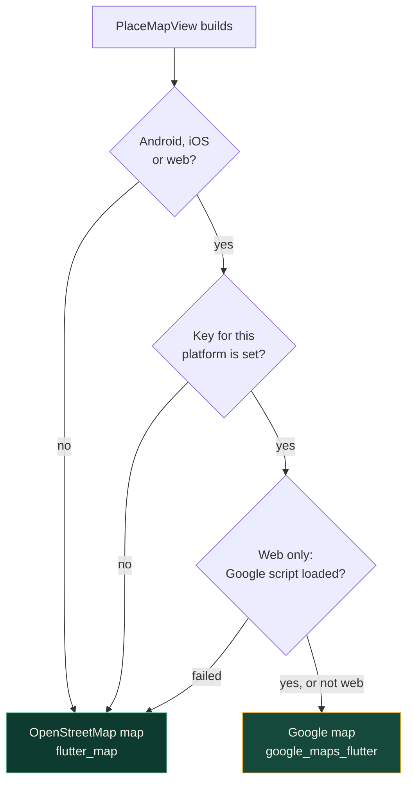
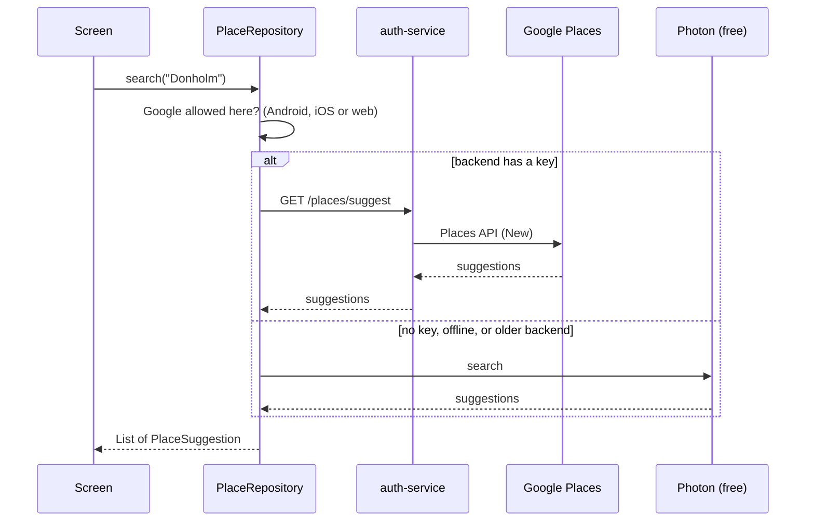

# Maps and address search



The app shows maps in two places: the **location picker** where someone sets where they are, and the **preview** on their profile. Both use one widget, `PlaceMapView`, and it chooses the engine for you. This page covers how that choice is made, how to create the Google keys, and what to check when a map misbehaves.

**You do not need any of this to run the app.** With no keys it uses OpenStreetMap everywhere and free address search, and everything works.

**On this page**
[How the map is chosen](#how-the-map-is-chosen) |
[Create the keys](#create-the-keys) |
[Put the keys in the app](#put-the-keys-in-the-app) |
[iOS](#ios) |
[Address search and the backend key](#address-search-and-the-backend-key) |
[How the code is organised](#how-the-code-is-organised) |
[Costs](#costs) |
[When something is wrong](#when-something-is-wrong)

## How the map is chosen



The screen is never left without a map: any failure on the way ends at OpenStreetMap. The rule lives in `AppConfig.useGoogleMap`, which is true only on a platform where Google has a map component **and** a key for that platform is set.

| Platform | Map | Address search |
| --- | --- | --- |
| Android, iOS, web, with that platform's key | Google | Google through the backend when the backend has its key, Photon otherwise |
| Android, iOS, web, without the key | OpenStreetMap | Same rule as above, see the note below |
| Linux, Windows, macOS | OpenStreetMap | Photon, always |

The search rule is decided by the **platform**, not by the map key: where Google has a map component, the app asks the backend whether it has a Google key (`/places/status`) and uses Google suggestions if so. Google's terms ask that its place data be shown on a Google map, so **when you turn on the backend key, also set the map key for each platform you ship**. Do not leave a platform on OpenStreetMap while its search results come from Google.

Why desktop stays on OpenStreetMap: Google publishes a map component for Android, iOS and the web only. Because Google's terms keep its place data off other companies' maps, the app never uses Google's search results on desktop. A "Powered by Google" line appears under Google suggestions.

## Create the keys

You make **four** keys in the [Google Cloud console](https://console.cloud.google.com), three public ones for the app and one secret one for the backend. Do this once per Google Cloud project.

### Project and billing

1. Create a project (or reuse one) and **link a billing account** to it. Google Maps Platform requires billing, but gives a monthly free allowance, see [Costs](#costs).
2. Set a **budget with alerts** (Billing, Budgets and alerts) before anything else, so a mistake cannot become a large bill.
3. Enable the APIs you need under **APIs and services, Library**:

| API | For |
| --- | --- |
| Maps JavaScript API | The web map |
| Maps SDK for Android | The Android map |
| Maps SDK for iOS | The iOS map |
| Places API (New) | Address suggestions and place details, used by the backend |
| Geocoding API | Turning a point into an address, used by the backend |

### The four keys

Create each under **APIs and services, Credentials, Create credentials, API key**, give it a clear name, and **restrict it straight away**. An unrestricted key is a key anyone can use on your bill.

| Key | Restriction: application | Restriction: APIs | Goes in |
| --- | --- | --- | --- |
| Web | **Websites** (HTTP referrers): `http://localhost:3000/*`, plus your production domain `https://your-domain/*` | Maps JavaScript API | `GOOGLE_MAPS_WEB_KEY` |
| Android | **Android apps**: package name `com.premisave.premisave_frontend` and the SHA-1 of the signing key | Maps SDK for Android | `GOOGLE_MAPS_ANDROID_KEY` |
| iOS | **iOS apps**: bundle ID `com.premisave.premisaveFrontend` | Maps SDK for iOS | `GOOGLE_MAPS_IOS_KEY` |
| Server | **IP addresses**: the address of the server running the auth-service | Places API (New) and Geocoding API | The backend's `.env`, as `GOOGLE_MAPS_API_KEY` |

The first three are **public by design**: they ship inside the app, and the restrictions are what make them safe. The server key is a **secret**. It lives only in the backend's `.env`, and must never be put in the app, in a JSON file under `config/env/`, or in git.

**Getting the Android SHA-1.** The debug key is made on your machine, the release key is the one you sign the store build with. Register both, as separate entries on the same key:

```bash
# debug key
keytool -list -v -keystore ~/.android/debug.keystore -alias androiddebugkey -storepass android -keypass android | grep SHA1

# or let Gradle print every signing key it knows
cd android && ./gradlew signingReport
```

**For local development on the server key.** An IP restriction will block your own computer unless you add its address. For a first trial you can add your public IP, and tighten it again once you deploy.

## Put the keys in the app

The three public keys go in your environment JSON (a `.local.json` copy, which git ignores):

```json
{
  "GOOGLE_MAPS_ANDROID_KEY": "your-android-key",
  "GOOGLE_MAPS_IOS_KEY": "your-ios-key",
  "GOOGLE_MAPS_WEB_KEY": "your-web-key"
}
```

Leave a key empty and that platform uses OpenStreetMap. Then **stop the app and start it again**: Flutter reads these values only at launch, and a hot restart does not see them. This is the most common reason for "I added the key and still see OpenStreetMap".

How each platform receives its key:

| Platform | How the key reaches Google |
| --- | --- |
| Web | The app injects Google's script with the key at startup (`google_maps_loader_web.dart`), so the key is **not** written into `index.html` |
| Android | `android/app/build.gradle.kts` reads the same `--dart-define` values while building and places the Android key into the manifest as `com.google.android.geo.API_KEY` |
| iOS | The native app reads it from `Info.plist`, which takes it from a small local file, see below |

## iOS

The iOS key is read by the native side of the app, so it also needs to be in one file the build can see. That file is ignored by git, so your key never reaches the repository.

```bash
cd premisave_flutter_frontend
printf 'GOOGLE_MAPS_IOS_KEY=your-ios-key\n' > ios/Flutter/Maps.xcconfig
cd ios && pod install && cd ..
```

How it fits together: `ios/Flutter/Debug.xcconfig` and `Release.xcconfig` include `Maps.xcconfig` if it exists. `Info.plist` has `GMSApiKey` set to `$(GOOGLE_MAPS_IOS_KEY)`, and `AppDelegate.swift` hands it to `GMSServices.provideAPIKey`. The iOS deployment target is **14.0**, which the Google Maps SDK needs.

Two rules:

- Keep `GOOGLE_MAPS_IOS_KEY` **empty in the JSON too** if you have no `Maps.xcconfig`. The app then uses OpenStreetMap on iOS. A JSON key with no native key behind it gives a blank map.
- Without `Maps.xcconfig` the app still builds and starts. It just cannot draw Google's map.

## Address search and the backend key

Google's address search is called **through the backend**, so the secret key never reaches a phone. The app talks to four small endpoints on the auth-service:

| Endpoint | Purpose |
| --- | --- |
| `GET /places/status` | Is a Google key configured? The app asks once and remembers |
| `GET /places/suggest?q=...&country=...&session=...` | Suggestions while typing |
| `GET /places/details?id=...&session=...` | The full address and the point for a chosen suggestion |
| `GET /places/reverse?lat=...&lng=...` | "What is here?", for a point picked on the map |



To turn it on, put the **server** key in the backend's `.env`:

```text
GOOGLE_MAPS_API_KEY=<the server key, never the app keys>
```

and restart the backend. Leave it empty and the app uses the free Photon search, built on OpenStreetMap data. Google knows places like estates and ring roads far better, which is the reason to turn it on.

Two details worth knowing:

- Each search gets a **session token** (`newSession()`), which Google uses to bill the typing and the final choice as one request instead of one per keystroke.
- The fallback to Photon uses its **own** HTTP client, not the app's `ApiClient`, because the app's client carries the person's sign in token, which must never be sent to a third party.

## How the code is organised

All the map code lives in `lib/src/features/places/`.

| File | Job |
| --- | --- |
| `place_map_view.dart` | The one widget screens use. Chooses Google or OpenStreetMap. Defines `PlaceMapController` and the small `PlaceMapDelegate` both engines implement |
| `google_place_map.dart` | The Google implementation. Shows a spinner while the web script loads, falls back to OpenStreetMap if it cannot, applies a night style on dark themes |
| `osm_place_map.dart` | The OpenStreetMap implementation, on `flutter_map` |
| `google_maps_loader*.dart` | Loads Google's script on the web. The stub does nothing on Android and iOS, where Google's map ships inside the app |
| `map_picker_screen.dart` | The full screen picker: search box, pin, zoom, "Use my position" |
| `place_map_preview.dart` | The small read-only map on a profile |
| `place_searcher.dart`, `address_search_field.dart` | The search box and its suggestions list |
| `place_widgets.dart` | Shared pieces, including `PoweredByGoogle` |

To change which engine a screen uses you do not edit the screen: it only knows `PlaceMapView`. The same goes for a third engine, which would implement `PlaceMapDelegate` and be chosen in `place_map_view.dart`.

On the web, overlays drawn on top of the map (the search box and the zoom buttons) are wrapped in `PointerInterceptor`. Without it the browser sends taps to the map underneath.

## Costs

Google Maps Platform bills per use and gives a free monthly allowance on most products. Prices and allowances change, so check the current [pricing page](https://mapsplatform.google.com/pricing/) rather than trusting a number written here. To keep the bill predictable:

- Set a **budget alert** before you create a key.
- **Restrict every key.** An open key is the usual cause of a surprise bill.
- Keep the **session token** logic, it makes typing a single billable search.
- Use OpenStreetMap and Photon for development if you like: leave the keys empty.

For a large launch the free public OpenStreetMap tile server and Photon server are meant for modest use. Run your own, or use a provider with an account, and point the app at it with `MAP_TILE_URL` and `GEOCODER_URL`.

## When something is wrong

| What you see | Likely cause | What to do |
| --- | --- | --- |
| OpenStreetMap although you set a key | The app was not restarted, or the key is for another platform | Stop the app and run it again. Check the key for **this** platform is filled |
| Blank or grey map on the web, console shows `RefererNotAllowedMapError` | The page's address is not in the key's HTTP referrers | Add `http://localhost:3000/*` or your domain with `/*` |
| Console shows `ApiNotActivatedMapError` | The Maps JavaScript API is not enabled | Enable it under APIs and services, Library |
| Console shows `BillingNotEnabledMapError` | The project has no billing account linked | Link one under Billing |
| Blank map on Android | Wrong package name or SHA-1 on the key, or the Android SDK is not enabled | Register the SHA-1 of the key you signed this build with. Debug and release are different |
| Blank map on iOS | No `Maps.xcconfig`, or a different bundle ID on the key | Create the file, check the bundle ID, run `pod install` |
| Address suggestions look like free map data | The backend has no Google key, or the app could not reach it | Set `GOOGLE_MAPS_API_KEY` on the backend and restart. `GET /places/status` should say enabled |
| Suggestions work in a browser, not on the server | The server key is restricted to another IP | Add the server's address to the key |
| Taps do nothing over the map on the web | A new overlay was added without `PointerInterceptor` | Wrap it |
| Google suggestions vanish on desktop | By design: no Google map there | Nothing to fix. Desktop uses Photon |
