# Messenger

The Messages tab talks to the **premisave-messenger-service**. It is a second backend next to the auth-service. The app signs in once, with the auth-service, and sends the same access token to the messenger service. When the token expires the auth-service refreshes it, for both.

## What it does

| Area | What you can do |
| --- | --- |
| Chats | Private chats, search, mark as unread, delete a chat, unread badge on the Messages tab |
| Messages | Send text, reply, edit text or a file's caption within the allowed time, delete for me or for everyone, copy, retry a failed send, search inside a chat, mention people in a group |
| Reactions | Tap an emoji under a message, or long press for the full emoji list |
| Files | Photos, videos, audio and documents with a progress ring. Each file shows a preview in the chat, opens inside the app and can be downloaded into a folder you choose (see Files and downloads) |
| Live | New messages, delivery ticks and read receipts, typing, online and last seen, reactions and group changes all arrive over the socket |
| Groups | Create, picture, name, description, add and remove members, admins, make someone the owner, leave. An owner must choose a new owner before leaving |
| Invites | Invite link and QR code with an expiry and a use limit, revoke, join by link, join by scanning a QR code, tap an invite link inside a message |
| Statuses | Text, photo, video and audio statuses for up to a day, view, like, react, comment, who saw it, past statuses |
| Calls | Voice and video calls from any chat, group calls, call links, screen share, a chat inside the call, host controls, call history |
| Call recording | A host or co-host records a call. Everyone who was in it can watch the video afterwards. An administrator switches it on or off and sees where the videos are stored |

## Files and downloads

**In the chat.** A photo shows the picture. A PDF shows its first page. A small text file shows its first lines. A video shows a poster with a play button. Audio has a player in the bubble. Word, Excel, PowerPoint, archives and everything else show a coloured tile with the file type. Under each file are its name, size and a download button that turns into a progress ring, then a tick.

**Opening.** Tap a file to open it inside the app. Photos zoom, PDFs scroll, text files can be selected, audio and video play. Other types show their details and a button to download them and open them with another app. On Linux and Windows the video plugin does not exist, so videos open in the system player once downloaded.

**Saving.** Files are saved to `Downloads/Premisave`, in a subfolder for each kind, the way WhatsApp and Telegram do it:

| Kind | Default folder |
| --- | --- |
| Photos | `Premisave Images` |
| Videos | `Premisave Video` |
| Audio | `Premisave Audio` |
| PDF, Word, Excel, PowerPoint, text | `Premisave Documents` |
| Archives and anything else | `Premisave Other` |

Open **Messenger settings** (the gear in the Messages header) to change the main folder or any single subfolder, and to see the files you have saved. Folder choices apply to the phone and computer apps. A web browser saves into its own Downloads folder and does not allow subfolders. When a folder cannot be written to, for example because the system forbids it, the file is saved in the app's own folder so it is not lost.

**Editing.** Press and hold a message (or right click it, or use the arrow that appears on a bubble when the pointer is over it) and choose Edit. Press Esc to cancel. For a photo or file this edits the caption. The server decides how long a message can be edited: `MESSAGE_EDIT_WINDOW_HOURS`, one hour by default.

## Settings

Two keys, both optional, in the files under `config/env/`:

| Key | Default |
| --- | --- |
| `MESSENGER_URL` | `http://localhost:8081`, or `http://10.0.2.2:8081` on the Android emulator |
| `GROUP_INVITE_BASE_URL` | `https://premisave.com/join` |

On a real phone use your computer's address on the network, for example `--dart-define=MESSENGER_URL=http://192.168.1.20:8081`. Restart the app after changing a key.

## Running it



1. Start the auth-service on port 8080.
2. Start the messenger service on port 8081. It needs MongoDB and Redis, and it must use the same `JWT_SECRET` as the auth-service so the token is accepted.
3. For calls, start LiveKit (and the recorder, for recording) from `deploy/livekit` in the messenger repository, and set `LIVEKIT_API_KEY` and `LIVEKIT_API_SECRET` for the messenger. The steps, with the commands to check and stop it, are in [Set up and run LiveKit](https://github.com/peacemakerbill/premisave-messenger-service#set-up-and-run-livekit).
4. Run the app as usual.

Both services ship with a Docker setup, so on a development machine this is two commands, one in each repository, with no Java or databases to install:

```bash
cd premisave_auth_service       && docker compose up --build   # port 8080, with its own MongoDB and Redis
cd premisave-messenger-service  && docker compose up --build   # port 8081, reaches the auth-service on your machine
```

Staging and production use the same image with their own settings (`SPRING_PROFILES_ACTIVE=staging` or `prod`), and each repository has ready files for Docker Compose, Coolify, Render, Heroku, Fly.io and Railway. See `deploy/README.md` in each. Staging pairs with the staging auth-service and production with the production one.

The messenger service must also allow the app's origin when you run on the web (CORS and the STOMP endpoint `/ws-messenger`). On the web the socket cannot send headers, so the app sends the token in the STOMP CONNECT frame, which is what the service reads.

## Where the code is

| Folder or file | Job |
| --- | --- |
| `lib/src/core/network/messenger_socket.dart` | STOMP over a plain WebSocket, with reconnect and heartbeat |
| `lib/src/data/repositories/messenger_repository.dart` | Every REST call |
| `lib/src/data/models/messenger_models.dart` | Chats, messages, groups, invites, statuses |
| `lib/src/state/messenger_controller.dart` | Holds the chats and open conversations, sends optimistically, reacts to live events |
| `lib/src/state/messenger_providers.dart` | Group, invite and status data for the screens |
| `lib/src/state/file_downloads.dart` | Download folders, the list of saved files and download progress |
| `lib/src/core/files/` | File kinds and folders, and saving files (real folders on phones and computers, the browser's download on the web) |
| `lib/src/features/messenger/` | All the screens and widgets |

## Group invite links from outside the app

A link such as `https://premisave.com/join/CODE` opens `/join/CODE` in the app, which shows the group and a Join button. Opening links from the system into the app needs the usual platform setup (Android app links, iOS associated domains) and is not part of this change. Scanning the QR code inside the app, or pasting the link on the join screen, works everywhere.

## Camera permission for scanning

- **Android** and **iOS**: the camera permission and the iOS usage text are already declared in `AndroidManifest.xml` and `Info.plist`. The first scan asks the person to allow the camera.
- **macOS**: add `NSCameraUsageDescription` to the macOS `Info.plist` and the camera entitlement if you want scanning there.
- **Web**: needs HTTPS or localhost.
- **Linux and Windows**: no camera scanner. The join screen asks for the pasted link instead.

## Notifications

A bell in the Messages header opens the notifications. It shows how many are unread. Each one says what happened to you in a group: you were made an admin or the owner, your admin role was removed, you were added to a group, or you were removed from one. Tap one to mark it read and open the group's chat. Use the menu on a row to delete it, or the icons in the top bar to mark everything as read or clear the list.

New ones arrive live on the `/user/queue/notifications` channel, so the bell updates and a short message appears on screen right away. The messenger service also stores them, so ones that came while you were offline are waiting in the list, and it emails them through auth-service (see the messenger README for `INTERNAL_API_KEY`).

Nothing is sent to the person who did the action themselves.

## Calls

Voice and video calls live inside Messenger. The messenger service (see its `docs/CALLS.md`) decides who is in a call and hands out tokens. The audio, video and screen share travel between the app and a LiveKit server, using the `livekit_client` package. Nothing about calls works until LiveKit is running and the messenger service has `LIVEKIT_API_KEY` and `LIVEKIT_API_SECRET` set.

What the app does:

- **Call from a chat.** A video and a voice button sit in every chat header. In a group, everyone is rung at once. If a call is already running in the chat, the same buttons join it, and a green strip above the messages says "Call in progress, Join".
- **Incoming calls.** They ring over whatever screen is open, with a ringtone, and over the call screen as a small banner when someone is already on a call.
- **In the call.** Mute, camera on and off, flip camera and speaker on phones, share screen, raise hand, reactions, a chat that only the people in the call see, and a People list. A host can mute people, mute everyone, make a co-host, hand over hosting, remove someone, lock the call and add people while it runs. Anyone in the call can add people.
- **Layouts.** A grid, a speaker view, and a presentation view that fills the stage when someone shares a screen. In a one to one call the other person fills the screen and your own camera floats in a corner (tap to swap). Tap a tile to pin it.
- **Minimise.** The down arrow shrinks the call to a green bar above the app. Tap the bar to come back. The Android back button also minimises.
- **Recording.** While recording is on, a host or co-host sees a Record button in the call and everyone sees a red Recording sign. The video is ready a few seconds after it stops. It appears under the call in the Calls tab (open the call), where anyone who was in it can watch, download or, for the person who started it and hosts, delete it. If the server's storage is not ready, Record answers with the reason and nothing is lost.
- **Calls tab.** The Messages screen has a Calls tab: create a call link, join with a link, and the list of calls made and missed with a call back button. A call also appears in the chat as a line (Missed video call, Voice call, 3 min).
- **Call links.** `https://premisave.com/call/CODE` opens `/call/CODE`, which shows who is on the call and a Join button. Pasting a link on the Calls tab does the same.

| Folder or file | Job |
| --- | --- |
| `lib/src/state/call_controller.dart` | Rings, owns the call being joined (the LiveKit room, microphone, camera, screen share, hand, reactions, call chat) |
| `lib/src/state/call_providers.dart` | Call history and the call running in a chat |
| `lib/src/data/repositories/call_repository.dart` | Every call REST call |
| `lib/src/data/models/call_models.dart` | Calls, people, events, call chat |
| `lib/src/features/calls/` | The call screen, incoming call card, minimised bar, Calls tab, call details with recordings, call link screen |
| `lib/src/features/admin/admin_call_settings_screen.dart` | The recording switch and the storage status, for administrators |
| `assets/sounds/` | Ringtone, ringback tone, join and leave sounds. `tool/call_sounds.py` makes them again |

### Storage settings

Administrators open **Settings, Storage** (or the Settings tab for administrators, route `/admin/storage`). The screen has three parts, each loaded on its own so one service being down does not hide the others: home owner documents (auth-service, `/admin/storage-settings`), chat files and call recordings (messenger, `/api/storage-settings`). Each part shows the source (From .env or Set in dashboard), the folder in use, free space and any problem. **Try it** creates the folder and writes a test file without saving, **Save** makes the dashboard value win, and **Reset to .env** goes back. Every folder field has a folder button that opens a picker with the server's own folders (not the device's), where an administrator can open folders, go up, add a **New folder** and press **Use this folder**; typing a path still works. The picker shows only the folders the server allows (`STORAGE_ALLOWED_ROOTS` in the auth-service and messenger `.env` files, each with its own list), so to reach other folders widen that setting on the server and restart it. For recordings only a folder inside the recorder's folder and the free-space limit can be chosen, because the recorder runs in Docker and writes only to the folder mounted into it (`CALLS_RECORDINGS_HOST_DIR`). The Storage row on the Calls page opens this screen.

### Call settings

Recording is controlled by the administrators, and the app asks the messenger service (`GET /api/call-settings`) so it can hide recording completely while it is off.

- **Messages, Settings, Calls** (the gear in the chat list) shows whether recording is on. A person who is not an administrator only reads it. An administrator opens the entry to reach the full screen.
- **The full screen** (also the Settings tab for administrators, route `/admin/calls`) has the switch, and shows where the videos are stored (this server or a network share), whether the storage is ready, the folder, the free space and any problem, for example a share that is not mounted.
- A change reaches every open app straight away through the `RECORDING_SETTING` event, so the Record button appears or disappears without restarting.
- Where the videos are kept is a server setting (`CALLS_RECORDINGS_MODE`, `LOCAL` or `NETWORK`), described in the messenger service's `docs/CALLS.md`. The app only shows it.

### Platform notes

- **Android**: camera, microphone, Bluetooth and foreground service permissions are in `AndroidManifest.xml`. Screen sharing shows a notification while it runs (that is Android's rule). On the emulator the app swaps `localhost` for `10.0.2.2` in the media server address.
- **iPhone and iPad**: camera and microphone texts and background audio are in `Info.plist`. Sharing the screen from iOS needs a broadcast extension and is not in the app, so the share button is hidden there.
- **macOS**: camera, microphone and network entitlements are added. The first call asks for permission.
- **Linux and Windows**: the share button opens a picker of screens and windows. On Linux with Wayland, capturing may be limited; the X11 session works best.
- **Web**: needs HTTPS or localhost for the camera and microphone. The browser's own screen picker opens when sharing.

### Not included

Calls ring only while the app is open or running in the background. There is no push ringing when the app is closed (that needs FCM and APNs, and CallKit on iPhone). There is no waiting room.
