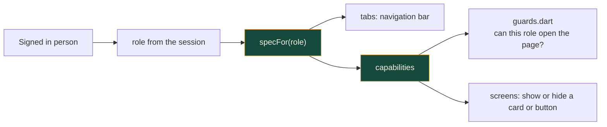

# Roles and access



Everyone signs in to the same app. This page explains how the app decides what each person sees, and how to add a role, a capability or a guarded page without scattering `if (role == ...)` checks through the screens.

The grid above is generated from `lib/src/roles/role_registry.dart` by `tool/readme_assets.py`, so it always matches the code.

**On this page**
[The idea](#the-idea) |
[The three files](#the-three-files) |
[How a decision is made](#how-a-decision-is-made) |
[Add a capability](#add-a-capability) |
[Add a guarded page](#add-a-guarded-page) |
[Add a role](#add-a-role) |
[What the backend does](#what-the-backend-does)

## The idea

A **role** is what an account is: client, home owner, operations, finance, support or administrator. A **capability** is something a person may do: explore properties, review applications, manage users.

Screens never ask which role someone has. They ask whether the role has a capability:

```dart
// Good: survives any change to the list of roles
if (role.can(Capability.manageUsers)) ...

// Bad: has to be found and edited every time a role is added
if (role == Role.admin) ...
```

The mapping from role to capabilities exists in **one** table. Change the table and the whole app follows: the tabs in the navigation bar, which pages open, which cards appear on Home.

## The three files

| File | Holds |
| --- | --- |
| `roles/role.dart` | The `Role` enum, the value the backend uses for each (`CLIENT`, `HOME_OWNER` and so on), a display label, and `Role.parse` for reading the backend's value |
| `roles/permissions.dart` | The `Capability` enum. Each value has a one line comment saying what it unlocks |
| `roles/role_registry.dart` | One `RoleSpec` per role: its tabs, its capabilities and the title of its dashboard. Plus the `can`, `tabs` and `overviewTitle` helpers on `Role` |

A `RoleSpec` looks like this:

```dart
const RoleSpec _admin = RoleSpec(
  tabs: <AppTab>[AppTab.home, AppTab.applications, AppTab.users, AppTab.people, AppTab.account],
  capabilities: <Capability>{
    Capability.reviewApplications,
    Capability.approveApplications,
    Capability.manageUsers,
    Capability.viewAuditTrail,
  },
  overviewTitle: 'Administrator overview',
);
```

And the function that connects a role to its spec has **no default case**:

```dart
RoleSpec specFor(Role role) {
  switch (role) {
    case Role.client:   return _client;
    case Role.homeOwner: return _homeOwner;
    // ...
    case Role.admin:    return _admin;
  }
}
```

Because there is no `default`, adding a value to `Role` without adding its spec is a **compile error**. A new role cannot ship half configured.

## How a decision is made



Three places read the registry:

1. **The navigation.** `features/shell/nav.dart` builds the bar from `role.tabs`. A tab that is not in a role's list does not exist for that role.
2. **The router.** `router/guards.dart` maps a path prefix to the capability it needs, and `canOpen(role, location)` is called from the router's redirect. A role without the capability is sent to Home.
3. **Individual screens.** Home, Account and the review screens call `role.can(...)` to decide whether to draw a card or a button, for example the Approve button only appears for `Capability.approveApplications`.

A guarded path and the capability it needs, in full:

```dart
const List<(String, Capability)> _guarded = <(String, Capability)>[
  ('/admin/audit', Capability.viewAuditTrail),   // most specific prefix first
  ('/admin', Capability.manageUsers),
  ('/staff', Capability.reviewApplications),
  ('/explore', Capability.exploreProperties),
  ('/home/lookup', Capability.lookupAccounts),
  ('/home/properties', Capability.manageProperties),
  ('/home/listings', Capability.manageProperties),
  ('/home/tenancy', Capability.useClientWorkspace),
];
```

Pages not in the list are open to every signed in person. The most specific prefix comes first, which is why `/admin/audit` sits above `/admin`.

> **Hiding is not security.** These checks decide what the app shows. The real enforcement is the backend: a request the role may not make is refused with 403 whatever the app displays. Treat the app's checks as good manners and the backend's as the lock.

## Add a capability

Say staff should be able to export a report.

1. Add a value to `Capability` in `permissions.dart`, with a comment:

   ```dart
   /// Download the applications report as a file.
   exportReports,
   ```

2. Add it to the roles that should have it in `role_registry.dart`:

   ```dart
   const RoleSpec _finance = RoleSpec(
     tabs: <AppTab>[...],
     capabilities: <Capability>{Capability.reviewApplications, Capability.exportReports},
     overviewTitle: 'Finance overview',
   );
   ```

3. Use it where it matters: `if (role.can(Capability.exportReports)) ...`.

No other file changes. If the capability protects a whole page, see the next section.

## Add a guarded page

1. Build the screen and its route, as in [ARCHITECTURE.md](ARCHITECTURE.md#add-a-feature-step-by-step).
2. Add the capability it needs (above), if none of the existing ones fit.
3. Add one line to `_guarded` in `router/guards.dart`:

   ```dart
   ('/reports', Capability.exportReports),
   ```

That is all. A person without the capability who opens `/reports`, by a link or by typing the address, lands on Home.

## Add a role

Say you want a `landlord` role.

1. **`roles/role.dart`.** Add `landlord` to the enum, its backend value in `api` (`'LANDLORD'`) and its `label`. `Role.parse` finds it automatically from the value.
2. **`roles/role_registry.dart`.** Write a `RoleSpec` (`_landlord`) and add `case Role.landlord: return _landlord;` to `specFor`. The compiler will not let you skip this.
3. **`features/overview/`.** Build the role's dashboard in its own folder, `overview/landlord/landlord_overview.dart`, and add one case to `RoleOverviewPage._bodyFor`. This is the only place that picks a dashboard. The switch has no default either, so the compiler reminds you.
4. **The backend.** The auth-service has to know the role too, so it can be assigned and its permissions enforced there. See below.

Every role's dashboard is built from live data, and the pattern is the same for all of them: read each part from its own provider (`state/overview_providers.dart` for the finance, operations and support parts, `state/service_providers.dart` for the rest), wrap each part in `OverviewLoad`, which shows a skeleton while it loads, an error with a retry, and the content when it arrives, and use `overviewFigure` for the numbers in the hero so a figure shows a dash when its service is down. One service being down does not hide the rest, and pull down refreshes every part. `features/overview/admin/admin_overview.dart` and `finance/finance_overview.dart` are good ones to copy. [SERVICES.md](SERVICES.md#role-dashboards) lists the calls each role's overview makes.

Nothing else is needed: the tabs, the guards and the cards on Home follow from the spec.

## What the backend does

The role comes from the auth-service with the signed in user (`GET /profile/me`), and `Role.parse` is forgiving about its spelling: it ignores case, a `ROLE_` prefix and underscores. An unknown value becomes `client`, the safest default.

An administrator changes another account's role from the **Users** tab, which calls the backend's role change endpoint. The change takes effect the next time the person's profile loads: the session controller watches the role and the router re-evaluates, so a person whose role changed while the app was open is moved to a page they may open.
