# Connecting the backend services

The app talks to seven Spring Boot services. This page says which screen uses which service, how each call is made and signed, and what to check when one of them does not answer.




| Service | Repository | Port | App setting | Who it trusts | Used by |
| --- | --- | :---: | --- | --- | --- |
| [auth-service](https://github.com/peacemakerbill/premisave_auth_service) | `premisave_auth_service` | 8080 | `BASE_URL` | Issues the token | Sign in, profile, security, administration, places |
| [messenger](https://github.com/peacemakerbill/premisave-messenger-service) | `premisave-messenger-service` | 8081 | `MESSENGER_URL` | The auth token | Chats, calls, storage settings |
| [listing-service](https://github.com/peacemakerbill/premisave-listing-service) | `premisave-listing-service` | 8082 | `LISTING_URL` | The auth token | Explore, bookings, wishlists, owner listings |
| [wallet-service](https://github.com/peacemakerbill/premisave-wallet-service) | `premisave-wallet-service` | 8084 | `WALLET_URL` | The auth token | Payments, transactions |
| [property-service](https://github.com/peacemakerbill/premisave-property-management-service) | `premisave-property-management-service` | 8085 | `PROPERTY_URL` | The auth token | Property management, my tenancy |
| [c2b-hakikisha](https://github.com/peacemakerbill/premisave-c2b-hakikisha-service-m-pesa) | `premisave-c2b-hakikisha-service-m-pesa` | 8090 | `C2B_URL` | Its own client credentials | M-Pesa name lookup (staff) |
| [developer-service](https://github.com/peacemakerbill/premisave-developer-service) | `premisave-developer-service` | 8091 | `DEVELOPER_URL` | Its own login | Developer portal |

Start the services you need, run the app, and every address already points at `localhost` with the port above. On the Android emulator the host is `10.0.2.2` instead, and the app chooses it for you.

## How a call is made

There are two kinds of client, and a repository picks one.

**`ApiClient`** is for the services that trust the auth-service token (messenger, listing, wallet and property). A second `ApiClient` is created with a different base URL and **shares the same token store**, so one sign in covers all of them. It leaves out the `X-Client-Platform` and `X-Device-Token` headers, which only the auth-service understands. When a request gets a 401, the client asks the auth-service client to refresh, because the refresh token belongs to the auth-service, and then sends the request again.

**`ServiceClient`** is for the two services that do not accept that token. It is small on purpose: it sends `Accept` and, when it has one, `Authorization`, and it turns every failure into an `ApiException` with a readable message. It never refreshes anything.

```dart
// lib/src/state/providers.dart, one shared helper builds the secondary clients
final walletApiClientProvider = Provider<ApiClient>((ref) => _sharedSessionClient(ref, AppConfig.walletUrl));
final listingApiClientProvider = Provider<ApiClient>((ref) => _sharedSessionClient(ref, AppConfig.listingUrl));
final propertyApiClientProvider = Provider<ApiClient>((ref) => _sharedSessionClient(ref, AppConfig.propertyUrl));
```

### Two shapes of answer

The services do not all answer the same way, and the repositories hide it.

| Service | Shape | Helper |
| --- | --- | --- |
| Wallet, developer, C2B `/internal/accounts` | `{ "success": true, "message": "...", "data": ..., "timestamp": "..." }` | `unwrap`, `unwrapMap`, `unwrapList` in `data/repositories/envelope.dart` |
| Auth, listing, property, C2B lookup and token | The body itself. Bookings and interests come as a Spring `Page`, whose rows are in `content` | `asMap`, `mapList`, `pageContent` |

C2B reports an error as `{ "errorMessage": "..." }`, so `ApiException` reads that as well as `message`.

## Wallet

| Screen | What it does | Calls |
| --- | --- | --- |
| Payments (`wallet_screen.dart`) | Balance, deposit, transfer, withdraw, statement, recent activity | `GET /wallet`, `POST /wallet/create`, `POST /wallet/deposit`, `POST /wallet/transfer`, `POST /disbursements`, `POST /wallet/statement` |
| Transactions (`transactions_screen.dart`) | Four tabs: all, transfers, deposits, withdrawals | `GET /transactions/history`, `/wallet/transfer/history`, `/deposits/history`, `/disbursements/history` |

A person with no wallet yet sees a **Create wallet** button, which calls `POST /wallet/create`. Amounts go through `parseAmount`, and money is shown by `formatMoney`, which groups the digits and uses the currency the service returns.

Who sees it: clients and home owners (the `useWallet` capability).

## Listings

| Screen | What it does | Calls |
| --- | --- | --- |
| Explore (`explore_screen.dart`) | Search, filters, a detail page with availability, booking and interest | `GET /listings/search`, `GET /listings/{id}`, `GET /listings/{id}/availability`, `POST /bookings`, `POST /interests` |
| Bookings (`bookings_screen.dart`) | My bookings, with a cancellation quote before cancelling. Owners see the bookings they received | `GET /bookings/me`, `GET /bookings/received`, `GET /bookings/{id}/cancellation-quote`, `POST /bookings/{id}/cancel` |
| Wishlists (`wishlists_screen.dart`) | The listings I showed interest in, and the interests I received as an owner | `GET /interests/me`, `GET /interests/received`, `DELETE /interests/{id}` |
| My listings (`owner_listings_screen.dart`) | An owner's listings, create a listing, archive and unarchive | `GET /listings/me`, `POST /listings`, `POST /listings/{id}/archive`, `POST /listings/{id}/unarchive` |

A booking only carries the `listingId`, so `listingTitleProvider` looks the title up once per listing. Creating a listing is a bottom sheet (`listing_form.dart`). It asks for the category first and then only the fields that category needs: a short stay takes a price per night or per day, guests, rooms, Wi-Fi, kitchen, amenities and a cancellation policy; a long term rental takes the monthly rent, rooms, the shortest lease, furnished and tenant requirements; a house sale takes the price, rooms, floors, plot size, garage and type; a land sale takes the price, size in acres, land use and title deed; a lease takes the monthly price, deposit, length, renewable and terms. `ListingRepository.createListing` sends a multipart request with a `request` part that holds the details as JSON (content type `application/json`, which Spring needs for `@RequestPart`) and one `files` part per photo. The service accepts 20 photos, 10 MB each and 40 MB in all, so the form checks that before sending. A new listing waits for review, and the list refreshes when it is saved.

Booking sends an `Idempotency-Key` header (`newIdempotencyKey()` in `core/utils/ids.dart`). The key belongs to one listing and one set of dates, so a retry after a timeout or a second tap sends the same key and the service returns the first booking instead of making another. Changing the dates or the listing makes a new key, and a successful booking clears it.

## Property management

| Screen | What it does | Calls |
| --- | --- | --- |
| Property management (`owner_property_screen.dart`) | Owner dashboard, properties and their units, leases, maintenance requests with a status change | `GET /api/v1/owners/me/exists`, `POST /api/v1/owners/quick`, `GET /api/v1/dashboard/owner`, `GET /api/v1/properties/me`, `GET /api/v1/units/property/{id}`, `GET /api/v1/leases/owner`, `GET` and `PATCH /api/v1/maintenance` |
| My tenancy (`tenancy_screen.dart`) | Rent balance, leases, maintenance requests, notices, paying rent | `GET /api/v1/tenants/me`, `POST /api/v1/tenants/quick-register`, `GET /api/v1/rent/balance/me`, `GET /api/v1/leases/tenant/{id}`, `GET /api/v1/maintenance/tenant/{id}`, `POST /api/v1/maintenance`, `GET /api/v1/notices/tenant/{id}`, `GET /api/v1/rent/units/due/{id}`, `POST /api/v1/rent/units/pay`, `POST /api/v1/rent/pay` |

A person with no owner or tenant profile is offered a one tap profile first (`/owners/quick`, `/tenants/quick-register`). Paying rent is a wallet to wallet transfer made by the property service, so a failed payment usually means the wallet or the auth-service is down, and the message says so.

Who sees it: home owners see **Property management**, clients see **My tenancy**.

## Developer portal

| Screen | What it does | Calls |
| --- | --- | --- |
| Developer portal (`developer_portal_screen.dart`) | Sign in or sign up as a developer, see apps, create and suspend them, create, rotate and revoke API keys | `POST /api/v1/auth/login`, `/signup`, `/forgot-password`, `GET /api/v1/me`, `POST /api/v1/me/logout`, `GET` and `POST /api/v1/apps`, `/apps/{id}/suspend`, `/reactivate`, `GET` and `POST /api/v1/apps/{id}/keys`, `.../rotate`, `DELETE .../keys/{key}` |

A developer is not a Premisave user. The token is kept in secure storage under `ps_developer_token`, apart from the person sign in, and there is no refresh: when it expires the portal asks for the password again. A key and its secret are shown **once**, with a copy button, because the service only keeps a hash.

## M-Pesa name lookup

| Screen | What it does | Calls |
| --- | --- | --- |
| M-Pesa name lookup (`name_lookup_screen.dart`) | Staff check which name belongs to an M-Pesa number, and browse the accounts the service holds | `POST /oauth2/v1/generate`, `POST /api/v1/c2b/hakikisha/name-lookup`, `GET /internal/accounts` |

This service answers Safaricom, not people, so it cannot use the person's token. The screen asks for the service username and password (`HAKIKISHA_USERNAME` and `HAKIKISHA_PASSWORD` in the service's `.env`), trades them for a short lived token, and keeps both **in memory** by default, so closing the app forgets them. A person can tick **Remember on this device** to keep them in the device's secure storage (`ps_c2b_username` and `ps_c2b_password`), and the screen then connects by itself on the next start. **Forget the saved credentials** removes them. The option is not offered on the web. Who sees it: operations, finance, support and administrators (the `lookupAccounts` capability).

## Role dashboards

Each role's overview (`features/overview/`) reads its parts from separate providers (`state/overview_providers.dart` and `state/service_providers.dart`), so a part shows a skeleton while it loads and an error with a retry when its service is down, and the rest of the page still works. Pull down refreshes every part.

| Role | What the overview shows | Calls |
| --- | --- | --- |
| Client | Upcoming stays, saved places, total spent (from confirmed and completed bookings, in the currency paid), featured listings | `GET /bookings/me`, `GET /interests/me`, `GET /listings/search`, `GET /listings/{id}` |
| Home owner | Monthly rent, occupancy per property, maintenance requests, leases ending soon, the owner's listings and their review status. A person with no owner profile is offered a one tap profile | `GET /api/v1/owners/me/exists`, `GET /api/v1/dashboard/owner`, `GET /api/v1/leases/owner`, `GET /listings/me` |
| Operations | Live listings, newest listings and a count by category, today's deposits, withdrawals, transfers and payments, failed and waiting payments, payments per day for a week | `GET /listings/search`, `GET /admin/finance/reports/daily` (seven days) |
| Finance | Revenue today and for the week, money held for users (wallets plus escrow), largest wallets, latest deposits, frozen wallets, bookings that need review | `GET /admin/finance/reports/daily`, `/reports/balance-overview`, `GET /admin/finance/deposits`, `GET /admin/bookings/needs-review` |
| Support | Applications awaiting review, waiting on the applicant, unassigned, average decision time, the ones waiting longest and a count by status | `GET /staff/applications/stats`, `GET /staff/applications` |
| Administrator | People, applications, the 24 hour security summary, recent audit events and storage settings | auth-service and messenger admin endpoints |

The wallet's `/admin/finance` routes are open to administrators, finance and operations. The listing service's `/admin/bookings` routes are open to administrators and finance. A role that is refused a part sees that part's error and nothing else changes.

## Roles and screens

The Home screen builds its list from capabilities, so a person only sees what their role allows. The router refuses the same pages by capability, so typing a path does not get around it.

| Capability | Granted to | Opens |
| --- | --- | --- |
| `useClientWorkspace` | client | Bookings, Wishlists, Messages, My tenancy |
| `manageProperties` | home owner | Property management, My listings |
| `useWallet` | client, home owner | Payments, Transactions |
| `lookupAccounts` | operations, finance, support, administrator | M-Pesa name lookup |
| (none) | everyone signed in | Developer portal |

Routes: `/home/properties`, `/home/listings`, `/home/tenancy`, `/home/lookup` are guarded in `lib/src/router/guards.dart`. See [ROLES_AND_ACCESS.md](ROLES_AND_ACCESS.md) to change who gets what.

## Running it

Start the services you want, then the app. Nothing needs configuring when everything runs on this computer.

```bash
# the app on the port the backends already allow for browsers
flutter run -d chrome --web-port=3000 --dart-define-from-file=config/env/dev.local.json

# point one service somewhere else (empty means the default above)
#   config/env/dev.local.json
#   { "WALLET_URL": "http://192.168.1.20:8084", "LISTING_URL": "http://192.168.1.20:8082" }
```

Restart the app after changing a setting. Flutter reads them only at launch.

### Browser rules (CORS)

A phone or desktop app is not stopped by CORS. A browser is, so for the web build the service must allow the origin the app is served from (`http://localhost:3000` in development).

| Service | Setting | Default |
| --- | --- | --- |
| auth-service, messenger | none, any origin is allowed | `*` |
| listing-service | `CORS_ALLOWED_ORIGINS` | `http://localhost:3000` |
| wallet-service | `FRONTEND_URL` | `http://localhost:3000` |
| property-service | `CORS_ALLOWED_ORIGINS` | `http://localhost:3000`, `:4200`, `:5173` |
| c2b-hakikisha | `CORS_ALLOWED_ORIGINS` | `*` |
| developer-service | `DEVELOPER_PORTAL_ORIGINS` | empty, **set it** to `http://localhost:3000` for the web build |

The messenger, listing, wallet and property services check the token the auth-service signs, so each needs the same `JWT_SECRET` as the auth-service. The developer and C2B services keep their own secrets.

## When something does not work

| You see | Likely cause | Do this |
| --- | --- | --- |
| "Could not reach the server" on one screen only | That service is not running, or its setting points elsewhere | Start it, or fix the `*_URL` setting and restart the app |
| It works on Android, not in Chrome | The browser blocked the call | Allow `http://localhost:3000` in that service (table above) |
| 401 right after a good sign in | The service uses another `JWT_SECRET` | Use the auth-service value in that service's `.env` |
| A deposit or payment stays pending | The provider has not called back yet | Wait, then refresh the activity. The service matches the callback by reference |
| The developer portal asks for a password again | The developer token expired | Sign in again. It has no refresh |
| M-Pesa lookup says the credentials are wrong | The username or password differs from the service's `.env` | Use the `HAKIKISHA_USERNAME` and `HAKIKISHA_PASSWORD` the service was started with |

## Adding a service

1. Add `_envXUrl` and a `xUrl` getter to `AppConfig`, and the empty key to the three JSON files in `config/env`.
2. Add models in `data/models`, a repository in `data/repositories` and a provider in `state/providers.dart`. Use `_sharedSessionClient` when the service trusts the auth token, `ServiceClient` when it does not.
3. Add `FutureProvider`s in `state/service_providers.dart`, the screen under `features/`, and a route in `app_router.dart`.
4. Add a capability if only some roles should see it, then list the route in `guards.dart`.

Redraw the map above after adding a row to `SERVICES` in [`tool/service_pictures.py`](../tool/service_pictures.py).
