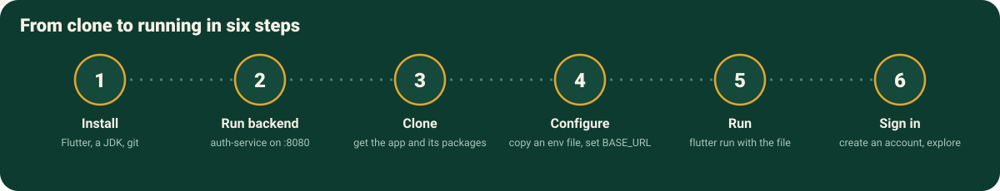
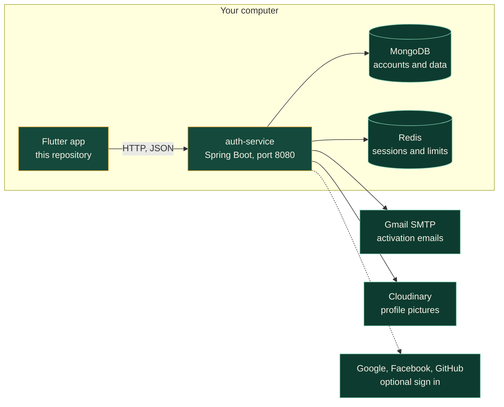

# Setting up Premisave from scratch



This guide takes you from a clean computer to a signed in app, and covers the things that usually go wrong on the way. If you only want the short version, the [README](../README.md#quick-start) has it. Everything here assumes nothing is installed yet.

**On this page**
[What you need](#what-you-need) |
[1. Install the tools](#1-install-the-tools) |
[2. Run the backend](#2-run-the-backend) |
[3. Get the app](#3-get-the-app) |
[4. Configure it](#4-configure-it) |
[5. Run it](#5-run-it) |
[6. First sign in](#6-first-sign-in) |
[Optional extras](#optional-extras) |
[Release builds](#release-builds) |
[Troubleshooting](#troubleshooting)

## What you need

The app is only the front half. It talks to the **auth-service** over HTTP, and the auth-service needs a database, a cache and an email account. Plan for these pieces:



| You need | For | Version |
| --- | --- | --- |
| Flutter | Building the app | Stable channel, with Dart 3.3 or newer |
| Java | Running the auth-service | 21 |
| Docker | MongoDB and Redis in one command (or install them yourself) | Any recent version |
| git | Getting the code | Any |
| A Gmail account with an App Password | The backend sends activation and reset emails | Free |
| A Cloudinary account | The backend stores profile pictures there | The free plan is enough |
| Android Studio, Xcode, Chrome | Only for the platform you run on | See each platform below |

## 1. Install the tools

### Flutter

Follow the official guide for your system: <https://docs.flutter.dev/get-started/install>. Then check it:

```bash
flutter --version      # Dart should be 3.3 or newer
flutter doctor         # lists what is missing for each platform
```

`flutter doctor` is the most useful command in this whole guide. Read every line it prints and fix the ones for the platforms you care about. You do not need all of them green: if you only want the web build, a green Chrome line is enough.

### Java 21, Docker and git

Install them with your usual package manager, or from [adoptium.net](https://adoptium.net) (Java), [docker.com](https://docs.docker.com/get-docker/) and [git-scm.com](https://git-scm.com).

```bash
java -version          # should say 21
docker --version
git --version
```

### Extra packages for desktop builds

Skip this unless you want to run on a desktop.

| System | Install |
| --- | --- |
| Linux (Debian, Ubuntu) | `sudo apt install clang cmake ninja-build pkg-config libgtk-3-dev libsecret-1-dev libjsoncpp-dev` |
| Windows | Visual Studio with the **Desktop development with C++** workload |
| macOS | Xcode from the App Store, then `sudo gem install cocoapods` or `brew install cocoapods` |

The Linux packages matter: the secure token storage uses `libsecret`, and a build without it fails with a linker error that does not mention the cause.

## 2. Run the backend

The backend lives in its own repository, with a long README of its own. This is the part you need to get a working sign in.

```bash
git clone https://github.com/peacemakerbill/premisave_auth_service.git
cd premisave_auth_service
```

**Start MongoDB and Redis.** If you already have them, skip this.

```bash
docker run -d --name auth-mongo -p 27017:27017 mongo:8
docker run -d --name auth-redis -p 6379:6379 redis:7
```

**Create the environment file.** The service reads its settings from a `.env` file next to `pom.xml`.

```bash
cp .env.example .env
```

Open `.env` in an editor and fill in the values. The ones the service **cannot start without**:

| Key | What to put there |
| --- | --- |
| `MONGODB_URI` | `mongodb://localhost:27017/premisave-auth` if you used the Docker command above |
| `REDIS_HOST`, `REDIS_PORT` | `localhost` and `6379` |
| `JWT_SECRET` | A long random value. Make one with `openssl rand -base64 32` |
| `API_KEY` | Another random value. Make one with `openssl rand -hex 32` |
| `FRONTEND_URL` | `http://localhost:3000`, the address of the web build. It goes into email links |
| `BACKEND_URL` | `http://localhost:8080` |
| `GMAIL_USERNAME`, `GMAIL_PASSWORD` | A Gmail address and its 16 character **App Password** (Google Account, Security, App passwords). Not your normal password |
| `CLOUDINARY_CLOUD_NAME`, `CLOUDINARY_API_KEY`, `CLOUDINARY_API_SECRET` | From your Cloudinary dashboard |
| `ADMIN1_EMAIL`, `ADMIN1_FIRST_NAME`, `ADMIN1_PASSWORD` | The first administrator account, created when the service starts. Sign in is by email |

Write values **without quotes and without trailing spaces**, and never commit `.env`. Treat it like a password file: it holds your mail password and signing secret. Social sign in and Google places search are optional and have their own keys, covered under [Optional extras](#optional-extras).

**Start it.**

```bash
sh ./mvnw spring-boot:run
```

First start downloads dependencies and takes a minute or two. You are looking for these lines:

```text
Tomcat started on port 8080 (http)
Started PremisaveAuthServiceApplication in ... seconds
```

Check it from another terminal:

```bash
curl http://localhost:8080/health
```

A plain text banner means the backend is ready. Leave it running.

## 3. Get the app

```bash
git clone https://github.com/peacemakerbill/premisave_flutter_frontend.git
cd premisave_flutter_frontend
flutter pub get
```

`flutter pub get` downloads the packages listed in `pubspec.yaml`. If you want to regenerate the launcher icons from `assets/brand` (you do not need to for a normal run), use `dart run flutter_launcher_icons`.

## 4. Configure it

The app takes its settings from a JSON file you hand to Flutter. The repository has one per environment in `config/env/`. Do not edit those for personal changes: copy one to a name that ends in `.local.json`, which git ignores.

```bash
cp config/env/development.json config/env/dev.local.json
```

For a first run on your own computer you usually change **nothing** except possibly `BASE_URL`, and you can leave `BASE_URL` empty to get the right default for the platform:

| Where the app runs | Default `BASE_URL` | Why |
| --- | --- | --- |
| Web, desktop, iOS simulator | `http://localhost:8080` | The backend is on the same computer |
| Android emulator | `http://10.0.2.2:8080` | `10.0.2.2` is the emulator's name for your computer |
| A real phone | Set it yourself, for example `http://192.168.1.20:8080` | Use your computer's address on the Wi-Fi network, with both on the same network |

All the other keys (social sign in, maps) are optional. What each key does is in [config/env/README.md](../config/env/README.md).

## 5. Run it

Pick a platform. In every case the command ends with the same flag, `--dart-define-from-file=config/env/dev.local.json`.

### Web

```bash
flutter run -d chrome --web-port=3000 --dart-define-from-file=config/env/dev.local.json
```

Use port **3000**. The GitHub sign in callback in development points at `http://localhost:3000/auth.html`, and the backend puts the same address in its email links. A different port works for everything except those two.

The launcher does the same and asks you where to run: `./run.sh` on Linux, macOS, WSL and Git Bash, and `run.bat` on Windows. It lists a browser, this computer's desktop, any plugged in phone and any emulator or simulator, and picks Chrome or Chromium for you. Skip the questions with flags:

```bash
./run.sh --platform web --env staging
./run.sh --device emulator-5554 --mode release
./run.sh --devices        # only list what Flutter can see
```

`APP_ENV=staging ./run.sh` still works. On Windows the same options are written `run.bat -Platform web -Env staging`.

### Android

1. Install **Android Studio** and, from its SDK manager, the Android SDK and command line tools. Accept the licences with `flutter doctor --android-licenses`.
2. Start an emulator from Android Studio's Device Manager, or plug in a phone with USB debugging on.
3. Run:

```bash
flutter run --dart-define-from-file=config/env/dev.local.json
```

The Android build reads the Google Maps key from the same JSON file while compiling, so you do not edit the manifest. On a real phone, set `BASE_URL` to your computer's network address first (see the table above), and make sure the computer's firewall allows port 8080.

### iOS

You need a Mac with Xcode.

```bash
cd ios && pod install && cd ..
flutter run -d ios --dart-define-from-file=config/env/dev.local.json
```

The simulator reaches the backend at `localhost`. For Google Maps on iOS you also need one small local file, described in [docs/MAPS_AND_PLACES.md](MAPS_AND_PLACES.md#ios). Without it the app still starts and falls back to OpenStreetMap.

### Linux, Windows and macOS

```bash
flutter config --enable-linux-desktop      # or --enable-windows-desktop, --enable-macos-desktop
flutter run -d linux --dart-define-from-file=config/env/dev.local.json
```

Use `-d windows` or `-d macos` on those systems. Desktop builds use OpenStreetMap, because Google has no map component for them. Google and Facebook sign in on Linux and Windows go through the browser, see [docs/SIGN_IN_PROVIDERS.md](SIGN_IN_PROVIDERS.md).

> **Changed a key in the JSON file? Restart.** Flutter reads `--dart-define` values only when the app is launched. Hot reload and hot restart do not see the change: stop the app and run the command again.

## 6. First sign in

1. Open the welcome screen and choose **Create account**. Fill the form and submit.
2. The backend emails an activation link. Open it and the verify screen finishes the job. The link points at `FRONTEND_URL`, so it opens the web build on port 3000.
3. Sign in. You land on **Home** as a client.

To try the staff and administrator screens, sign in with the account you put in `ADMIN1_EMAIL` and `ADMIN1_PASSWORD`. Administrators can change another account's role from the **Users** tab, which is the easiest way to see the other roles ([who can do what](../README.md#roles-and-access)).

If no email arrives, see [Troubleshooting](#troubleshooting). It is nearly always the Gmail App Password.

## Optional extras

None of these are needed to run the app. Each has its own guide.

| Extra | What it adds | Guide |
| --- | --- | --- |
| Google Maps keys | Google's map on Android, iOS and the web instead of OpenStreetMap | [MAPS_AND_PLACES.md](MAPS_AND_PLACES.md) |
| Google places search | Better address suggestions, through the backend | [MAPS_AND_PLACES.md](MAPS_AND_PLACES.md#address-search-and-the-backend-key) |
| Google, Facebook, GitHub sign in | The social buttons on the sign in screen | [SIGN_IN_PROVIDERS.md](SIGN_IN_PROVIDERS.md) |
| Your own themes | A new palette or texture | [THEMING.md](THEMING.md) |

## Release builds

Use the production file, and make sure it holds your real public URLs and keys:

```bash
flutter build web       --release --dart-define-from-file=config/env/production.json
flutter build apk       --release --dart-define-from-file=config/env/production.json
flutter build appbundle --release --dart-define-from-file=config/env/production.json
```

Before you ship, work through this list:

- [ ] `BASE_URL` is your real `https` address, not `localhost`.
- [ ] `SUPPORT_EMAIL` is an address you read.
- [ ] The backend's `FRONTEND_URL` and `BACKEND_URL` are the real addresses, so email links open the right place.
- [ ] The backend's CORS setting is tightened. It is open to every origin for development.
- [ ] Your production domain is on the web map key, and your release signing SHA-1 is on the Android map key.
- [ ] Redirect addresses for Google, Facebook and GitHub are registered with each provider and listed in the backend's `OAUTH_ALLOWED_REDIRECT_URIS`.
- [ ] You use your own address search and tile servers if you expect real traffic. The public ones are for modest use.
- [ ] No secret is in any file under `config/env/`. Those values ship inside the app.

## Troubleshooting

| What you see | Most likely cause | What to do |
| --- | --- | --- |
| `flutter: command not found` | Flutter is not on your PATH | Add the `bin` folder of the Flutter install to PATH and open a new terminal |
| The app opens but every request fails, or "Network error" | The backend is not running, or `BASE_URL` points at the wrong place | Open `BASE_URL/health` in a browser. On the Android emulator the address must be `10.0.2.2`, not `localhost` |
| A real phone cannot reach the backend | `localhost` means the phone itself | Use your computer's Wi-Fi address in `BASE_URL`, same network, port 8080 allowed through the firewall |
| Backend stops at start with a message about a missing property | A required key in `.env` is empty | Fill `MONGODB_URI`, `JWT_SECRET`, `API_KEY` and the mail and Cloudinary keys |
| Backend cannot connect to MongoDB or Redis | The containers are not running | `docker ps` should list both. Start them with `docker start auth-mongo auth-redis` |
| Sign up works but no email arrives | Gmail rejected the login | Use a 16 character **App Password** with no spaces, not the account password. Check the spam folder |
| The activation link opens a page that does not load | `FRONTEND_URL` does not match where the app runs | Set it to `http://localhost:3000` and restart the backend |
| Signed out again right after signing in | The clock is far off, or the backend was restarted with a different `JWT_SECRET` | Fix the system time. Keep `JWT_SECRET` the same between runs |
| 429 Too many requests | The rate limiter | Wait a minute. `RATE_LIMIT_REQUESTS_PER_MINUTE` in the backend `.env` sets the limit |
| A social button is missing | That provider is not configured for this platform | See [SIGN_IN_PROVIDERS.md](SIGN_IN_PROVIDERS.md) for what each platform needs |
| The map shows OpenStreetMap although I set a Google key | Flutter was not restarted, or the key belongs to another platform | Stop and rerun the app. Check you filled the key for the platform you run on |
| The map is blank or grey on Google | The key is restricted wrongly, or the API is not enabled | See [MAPS_AND_PLACES.md](MAPS_AND_PLACES.md#when-something-is-wrong) |
| Linux build fails at link time with `libsecret` | A system package is missing | Install `libsecret-1-dev`, see the desktop packages above |
| `Because premisave_flutter depends on ... version solving failed` | Flutter or Dart is older than 3.3 | `flutter upgrade` |
| Analyzer errors right after pulling new code | Packages changed | Run `flutter pub get` again |

Still stuck? Run `flutter doctor -v`, read the first error in the console rather than the last, and open an [issue](https://github.com/peacemakerbill/premisave_flutter_frontend/issues) with that error and your platform.
