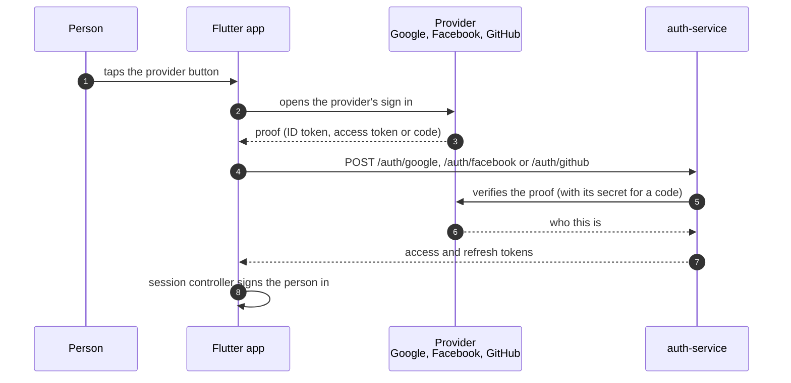

# Google, Facebook and GitHub sign in

Email and password sign in needs nothing but the backend. The three social buttons are optional. They are always on the sign in screen, and a button that cannot work on the current platform tells you why when you tap it, naming the key that is missing. This page explains what each one needs.

**On this page**
[How it works](#how-it-works) |
[One redirect address](#one-redirect-address) |
[Google](#google) |
[Facebook](#facebook) |
[GitHub](#github) |
[Checklist](#checklist) |
[Troubleshooting](#troubleshooting)

## How it works

The app never sees a provider's secret and never decides who someone is. It gets a **proof** from the provider and hands it to the backend, which checks it with the provider and signs the person in.

What the proof is depends on the platform, because each one has a different way to run the provider's screen:

| Platform | Google | Facebook | GitHub |
| --- | --- | --- | --- |
| Android, iOS | Google's own sign in (`google_sign_in`) returns an **ID token** | Facebook's SDK returns an **access token** | Browser window, returns a **code** |
| macOS | Google's own sign in | Facebook's SDK, needs `FACEBOOK_APP_ID` | Browser window, **code** |
| Web | Google's page in a popup returns an **ID token** in the address after `#` | Facebook's web SDK, needs `FACEBOOK_APP_ID` | Browser window, **code** |
| Linux, Windows | Browser, **code**. The backend swaps it for tokens with its secret | Browser, **code** | Browser window, **code** |

A **code** is a short lived value the provider hands back after the person approves. Only the backend, which holds the secret, can exchange it for tokens. That is why Linux and Windows need the backend to know the provider secrets: `google_sign_in` and Facebook's SDK have no implementation there.

## One redirect address

Every browser based flow ends by returning to a **redirect address**, and the app uses a single one for all of them: `GITHUB_REDIRECT_URI`. The name is historical; Google and Facebook on desktop reuse it.

| Where | Value |
| --- | --- |
| Development, web | `http://localhost:3000/auth.html`. This is the default in debug builds, so you set nothing |
| Production, web | `https://your-domain/auth.html` |
| Linux and Windows | The same address. The app listens on its port locally to catch the return |

`web/auth.html` is a tiny page that receives the return and hands it back to the app, by `postMessage` to the window that opened it. You do not edit it.

The same address must be registered in **three** places, and a mismatch in any of them is the most common cause of "redirect_uri mismatch":

1. The **provider's console** (Google Cloud, Facebook, GitHub).
2. The app's `GITHUB_REDIRECT_URI` in your environment JSON.
3. The backend's `OAUTH_ALLOWED_REDIRECT_URIS`, for Google and Facebook codes. It is an exact match, comma separated.

On Linux and Windows the app opens a local listener on the redirect's port, which is 3000 in development. **Close the web build of the app before you try desktop sign in**, or the port is taken and the app says so.

## Google

### Create the credentials

In the [Google Cloud console](https://console.cloud.google.com/apis/credentials), on your project:

1. **OAuth consent screen.** Fill in the app name and your email, and add your own address as a test user while the app is in testing.
2. **Create credentials, OAuth client ID, Web application.** Add:
   - Authorized JavaScript origins: `http://localhost:3000` (and your production origin).
   - Authorized redirect URIs: `http://localhost:3000/auth.html` (and your production one).
3. Copy the **client ID**. For Linux and Windows also copy the **client secret**.
4. For Android and iOS, create an **Android** client (package name and SHA-1) and an **iOS** client (bundle ID). They exist so Google trusts the app. Nothing from them goes into the JSON file.

### Where the values go

| Value | Where |
| --- | --- |
| Web client ID | App: `GOOGLE_SERVER_CLIENT_ID` and `GOOGLE_CLIENT_ID` in the environment JSON |
| Same client ID | Backend: `GOOGLE_CLIENT_ID` (comma separated if you have several clients) |
| Client secret | **Backend only**: `GOOGLE_CLIENT_SECRET`, used for the desktop code flow |
| Redirect address | App: `GITHUB_REDIRECT_URI`. Backend: `OAUTH_ALLOWED_REDIRECT_URIS`. Google: Authorized redirect URIs |

On Android the **server client ID** must be the web client ID. Without it Google returns no ID token and the app says so: *Google did not return an ID token. Set GOOGLE_SERVER_CLIENT_ID to your OAuth web client ID.*

The project has its own web client built in as the default, so the web build works with no setup on the project's own Google account. To use **your** Google project, put your client ID in both keys.

## Facebook

1. Create an app at [developers.facebook.com](https://developers.facebook.com), add the **Facebook Login** product.
2. Under Facebook Login settings, **Valid OAuth Redirect URIs**, add `http://localhost:3000/auth.html` and your production address.
3. Copy the **App ID** (public) and the **App Secret** (private).

| Value | Where |
| --- | --- |
| App ID | App: `FACEBOOK_APP_ID`. Needed on web, macOS, Linux and Windows. On Android and iOS it comes from the native configuration instead. Backend: `FACEBOOK_APP_ID` |
| App Secret | **Backend only**: `FACEBOOK_APP_SECRET`. It also lets Linux and Windows sign in by code |
| Redirect address | As above, plus the backend's `OAUTH_ALLOWED_REDIRECT_URIS` |

While the Facebook app is in development mode only the people you add as testers or developers can sign in.

## GitHub

1. GitHub, Settings, Developer settings, **OAuth Apps**, **New OAuth App**.
2. **Authorization callback URL**: exactly your `GITHUB_REDIRECT_URI`, for example `http://localhost:3000/auth.html`.
3. Create a **client secret** and copy it with the client ID.

| Value | Where |
| --- | --- |
| Client ID | App: `GITHUB_CLIENT_ID` (public). Backend: `GITHUB_CLIENT_ID` |
| Client secret | **Backend only**: `GITHUB_CLIENT_SECRET` |
| Callback URL | App: `GITHUB_REDIRECT_URI`. Must equal the OAuth app's callback URL |

GitHub is the one provider that works on **every** platform with the same flow, so it is a good first one to get working.

## Checklist

- [ ] The backend has the provider's ID and secret in its `.env`, and has been restarted.
- [ ] The redirect address is identical in the provider console, in `GITHUB_REDIRECT_URI` and in `OAUTH_ALLOWED_REDIRECT_URIS`.
- [ ] The app was **restarted** after you edited the JSON. Hot reload does not pick up `--dart-define` values.
- [ ] No secret is in any file under `config/env/`. The App Secret, the Google client secret and the GitHub client secret live in the backend's `.env` only.

## Troubleshooting

| What you see | Cause | Fix |
| --- | --- | --- |
| Tapping a button shows a message about a missing key | That provider is not set up for this platform | The message names the key. Set it, using the tables on this page, and restart the app |
| `redirect_uri_mismatch` or "URL blocked" | The redirect address differs in one of the three places | Make all three match character for character, including `http` or `https` and the port |
| "Port 3000 is already in use" on desktop | The web build of the app is still running | Close it and try again |
| Google says no ID token on Android | `GOOGLE_SERVER_CLIENT_ID` is missing or is not the web client | Use the **web** client ID |
| The popup opens and closes, nothing happens on web | A popup blocker, or `auth.html` was not reached | Allow popups for the site, and open `/auth.html` directly to check it loads |
| The backend answers 400 or 401 after the provider approved | The backend cannot verify the proof | Check its `.env` for the provider's ID and secret, and read its log |
| Facebook works for you but not for a friend | The app is in development mode | Add them as testers, or publish the app |

## Developer portal sign in

The developer portal (`/developers`) has its own accounts and its own OAuth clients, so it asks the developer service which client IDs to use (`GET /api/v1/auth/social/providers`) instead of reading them from the app's environment file. It follows the same split as the main sign in: web, Android, iOS and macOS send a token, while Linux and Windows open the browser, catch the code on the local port and send the code together with the redirect address. The developer service trades the code with the provider, so for Google it also needs `GOOGLE_CLIENT_SECRET` (Facebook and GitHub already have secrets there). Register `http://localhost:3000/auth.html`, the same redirect as above, under Authorized redirect URIs for Google and Valid OAuth Redirect URIs for Facebook.

**Facebook with an address that already has an account.** Facebook never vouches for the address it gives, so the developer service does not join it to an existing account on Facebook's word. The Facebook button then shows a message that a link went to the account's address (`next` is `CONFIRM_LINK` in the service's answer) and nothing is signed in. Opening the link lands on `/developers/link-provider?token=`, which joins Facebook to the account and tells the developer to sign in with Facebook again, which now goes straight in. This needs the developer service's mail to be configured; without it the service gives the plain "an account with this email already exists" message instead. Google and GitHub vouch for their addresses, so they join at once.

**Connecting from Profile.** A signed in developer can open Profile, then Sign in methods, and use Connect or Disconnect for Google, Facebook and GitHub. Connecting runs the same provider sign in as above, so the address of that account does not have to match. One account of each provider can be connected at a time, and the last way to sign in cannot be disconnected: an account with no password keeps at least one provider until a password is set under Change password.

Native sign in on Android, iOS and macOS needs each platform's own registration (Google services files, Facebook native configuration, URL schemes). The Dart side is written and the native files are not in this repository yet. Web, Linux, Windows and GitHub everywhere work with the steps above.
