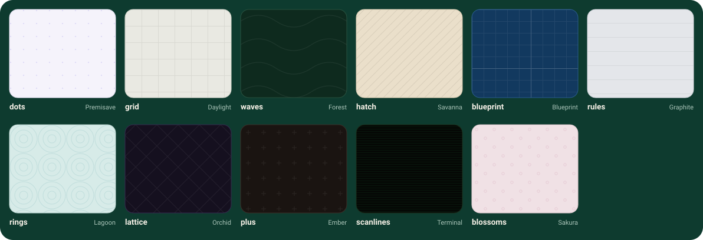

# Themes, textures, fonts and corners



The look of the app is four independent choices a person makes in **Account, Settings** (and from the welcome and sign in screens), and the app remembers them on that device:

| Choice | Options | Where it is defined |
| --- | --- | --- |
| **Theme** (colours and texture) | 14 palettes, or **Auto** to follow the device | `core/theme/palette.dart` |
| **Texture** | 11 background patterns, one per theme, plus none | `core/theme/pattern_painter.dart` |
| **Font** | 9 choices, from Plus Jakarta Sans to the device's own | `core/theme/appearance_options.dart` |
| **Corners** | Sharp, standard, soft | `core/theme/appearance_options.dart` |

Because they are separate, the same palette can look quite different with another font and corner style. And because every colour on screen comes from the active palette, adding a theme never means touching a screen.

Press **T** on a keyboard to step to the next theme and **Shift+T** for the previous one. It is ignored while typing in a field. A circular reveal plays when the theme changes, and is skipped when the device asks to reduce motion.

**On this page**
[How a palette works](#how-a-palette-works) |
[Use colour in a screen](#use-colour-in-a-screen) |
[Add a theme](#add-a-theme) |
[Textures](#textures) |
[Add a texture](#add-a-texture) |
[Fonts](#fonts) |
[Corners](#corners) |
[How it is saved](#how-it-is-saved) |
[Keep it readable](#keep-it-readable)

## How a palette works

An `AppPalette` is a set of named colours, and every one has a **job**, not a shade:

| Name | Job |
| --- | --- |
| `bg` | The page behind everything |
| `panel` | Cards, bars and sheets sitting on the page |
| `panel2` | Sunken areas inside a card |
| `field` | The inside of text fields |
| `ink`, `ink2`, `ink3` | Text: strong, normal, quiet |
| `line`, `line2` | Borders: subtle, stronger |
| `accent` | Buttons and anything that says "tap me" |
| `accentInk` | Text and icons **on** the accent colour |
| `accentSoft` | Tinted fills that belong to the accent |
| `good`, `bad`, `warn` | Success, error and warning |
| `hero` | The large feature panels |
| `pattern`, `patternColor`, `patternColor2` | The background texture and its line colours |
| `dark` | Whether this is a dark theme |

`AppTheme.build` turns a palette, a font and a corner style into a Flutter `ThemeData`, and attaches the palette to it as a theme extension, so any widget can reach it with `context.pal`.

## Use colour in a screen

```dart
@override
Widget build(BuildContext context) {
  final pal = context.pal;
  return Container(
    color: pal.panel,
    child: Text('Hello', style: TextStyle(color: pal.ink)),
  );
}
```

Never write a literal colour such as `Color(0xFF123456)` or `Colors.green` in a widget. It looks right in one theme and fails in the next: green text on a green theme, white text on a light one. If a screen needs a colour that does not exist yet, add it to the palette, not to the screen. The brand colours in `core/theme/brand.dart` are for the logo and fixed brand moments only.

## Add a theme

1. Open `lib/src/core/theme/palette.dart`.
2. Add a new `AppPalette(...)` to the `all` list, in the place you want it in the picker. Copy a neighbour and change the values:

```dart
AppPalette(
  id: 'dune',                         // unique, lowercase, saved on the device
  name: "Dune",
  note: "Warm sand with a quiet grid",   // the line under the name in the picker
  dark: false,
  bg: Color(0xFFEFE6D2),
  panel: Color(0xFFFBF7EC),
  panel2: Color(0xFFF3EBD8),
  field: Color(0xFFFFFFFF),
  ink: Color(0xFF2A2218),
  ink2: Color(0xFF5E5039),
  ink3: Color(0xFF75664C),
  line: Color(0xFFDDD0B4),
  line2: Color(0xFFBBA987),
  accent: Color(0xFF8A4B14),
  accentInk: Color(0xFFFFFFFF),
  accentSoft: Color(0xFFF0DDC4),
  good: Color(0xFF2E6A3A),
  bad: Color(0xFFA3231A),
  warn: Color(0xFF85580A),
  hero: Color(0xFF8A4B14),
  pattern: PatternKind.grid,
  patternColor: Color.fromRGBO(42, 34, 24, 0.08),
),
```

3. Run the app. It shows up in the picker, in the **T** key cycle and in the saved settings, with no other change.
4. Run `python3 tool/readme_assets.py` to add it to the picture at the top of this page.

An `id` that is no longer in the list is treated as **Auto**, so removing or renaming a theme never breaks a device that had it saved.

## Textures



A texture is drawn **behind** every screen by `AppBackdrop`, using a `CustomPainter` (`PatternPainter`), so it costs no images and scales to any screen. It glides diagonally at about 9 pixels a second. Each pattern repeats after a fixed distance (`PatternPainter.period`), so the glide wraps with no visible jump. It stops entirely when the device asks to reduce motion.

| Pattern | Used by | Drawn as |
| --- | --- | --- |
| `dots` | Premisave, Premisave Night, Midnight | A dot every 22 pixels |
| `grid` | Daylight | Fine lines every 28 pixels |
| `waves` | Forest | Gentle contour lines |
| `hatch` | Savanna | Diagonal lines every 14 pixels |
| `blueprint` | Blueprint | A fine grid with a bolder one every 100 pixels |
| `rules` | Graphite | Notebook lines every 24 pixels |
| `rings` | Lagoon | Concentric circles |
| `lattice` | Orchid | Diamonds |
| `plus` | Ember | Small crosses |
| `scanlines` | Terminal | A thin line every 4 pixels |
| `blossoms` | Sakura | Small circles in a staggered grid |

## Add a texture

1. Add a value to `PatternKind` in `palette.dart`.
2. In `pattern_painter.dart`, give it a repeat distance in `period()` and a drawing in `_draw()`. Both are `switch` statements without a default, so the compiler lists every place you have missed.
3. Use it in a palette with `pattern: PatternKind.yours`.
4. Optionally add the matching `<pattern>` to `pattern_def()` in `tool/readme_assets.py`, so the picture on this page shows it.

Keep texture lines **faint**, around 6 to 12 percent opacity, so text on top stays easy to read. A texture should be felt, not seen.

## Fonts

Nine choices, all bundled in `assets/fonts` so the app looks the same offline and on every platform:

| Choice | Text | Headings | Character |
| --- | --- | --- | --- |
| Premisave | Plus Jakarta Sans | Plus Jakarta Sans | Friendly and modern, the default |
| IBM Plex | IBM Plex Sans | IBM Plex Sans Condensed | Engineered and compact |
| Inter | Inter | Inter | Neutral and crisp |
| Grotesk | DM Sans | Space Grotesk | Geometric headings |
| Editorial | Source Sans 3 | Fraunces | Serif headings over clean text |
| Book | Source Serif 4 | Source Serif 4 | Long reading |
| Legible | Atkinson Hyperlegible | Atkinson Hyperlegible | Built for easy reading |
| Mono | JetBrains Mono | JetBrains Mono | Monospace everywhere |
| System | The device's font | The device's font | No download, no surprises |

To add one: put its `.ttf` files in `assets/fonts`, declare the family and weights under `fonts:` in `pubspec.yaml`, and add a `FontOption(id, name, note, sans, display)` to `FontOption.all`. Check the licence allows bundling.

## Corners

`CornerOption` carries one number, `scale`, that multiplies every corner radius in the shared components: **sharp** is 0.15, **standard** is 1 and **soft** is 1.5. Because shared widgets read it, one choice changes the buttons, cards, fields and sheets everywhere. Add your own with a new `CornerOption` in the list.

## How it is saved

`AppearanceController` keeps the choice in `shared_preferences` under three keys, `ps_theme`, `ps_font` and `ps_corner`, and `main()` reads them **before the first frame** so the app never flashes the wrong theme. A value that is no longer valid falls back to the default instead of failing.

**Auto** is the first-run default. It follows the device: Premisave in light mode and Premisave Night in dark mode. The very first version stored `ps_theme_mode` (`light`, `dark` or `system`), and that old value is still understood and converted.

## Keep it readable

Before you ship a theme, check these in the running app, in the picker and on a real screen:

- [ ] `ink` on `bg` and `panel` is easy to read. Aim for a contrast ratio of at least 4.5 to 1.
- [ ] `accentInk` on `accent` is easy to read, since every button uses that pair.
- [ ] `ink3`, the quiet text, is still readable on `panel`.
- [ ] `good`, `bad` and `warn` stand apart from each other and from `accent`, and do not rely on colour alone to carry meaning.
- [ ] The texture is faint enough that body text over it does not shimmer.
- [ ] It looks right with the **soft** and **sharp** corner styles, and with the **Mono** and **Book** fonts.

The **High contrast** theme is the reference for accessibility: pure black, no texture and a bright accent. If you are unsure about a change, compare against it.
